# Assignment 4 — Auto-Scaling & Auto-Healing: Let Kubernetes React for You

Part of the DevOps Micro Internship (DMI) with Agentic AI

---

## Purpose

Create Deployments, test Pod auto-healing, configure CPU requests and limits, verify Metrics Server, and create a Horizontal Pod Autoscaler.

Optionally generate CPU load to observe how the HPA responds.

---

# Task 0 — Check the Existing Cluster Resources

## Goal

Confirm that you are connected to your learning cluster and inspect existing Deployments and HPAs.

### Evidence

No screenshots required.

---

# Task 1 — Set Up Your Lab Directory

## Goal

Create and enter a dedicated directory for the auto-scaling lab.

### Evidence

#### Screenshot 1 — Terminal showing that you are working inside `~/k8s-labs/autoscaling`

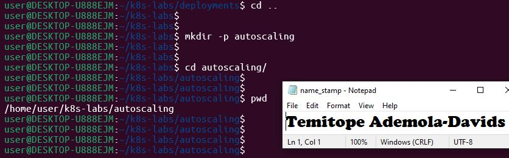

---

### Notes

**1. What is the difference between auto-healing and auto-scaling?**

Auto-healing (handled by controllers like ReplicaSets and Deployments using health probes or restart policies) detects when individual pods fail or become unhealthy and restarts or replaces them to maintain the desired pod count. Auto-scaling (handled by the Horizontal Pod Autoscaler) dynamically increases or decreases the total number of pod replicas based on resource utilization metrics (like CPU or memory) to handle fluctuating workloads.

---

**2. Which Kubernetes feature will you use for CPU-based auto-scaling?**

The Horizontal Pod Autoscaler (HPA), which automatically scales the number of pods in a deployment based on observed CPU utilization (or custom metrics).

---

# Task 2 — Test Auto-Healing with a Deployment

## Goal

Create a Deployment with two replicas, delete one Pod, and observe Kubernetes create a replacement Pod.

### Evidence

#### Screenshot 2 — Completed `autohealing-deployment.yaml` manifest

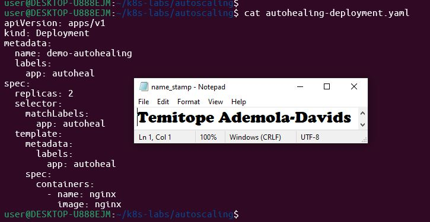

---

#### Screenshot 3 — Output of `kubectl get pods` showing two running Pods before deletion

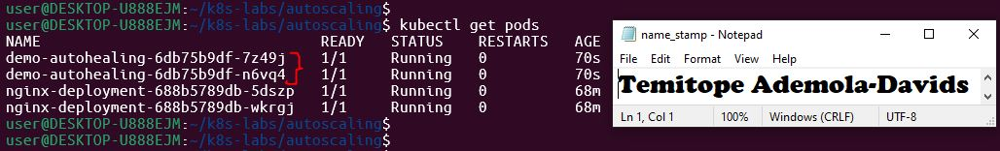

---

#### Screenshot 4 — Output of the `kubectl delete pod` command

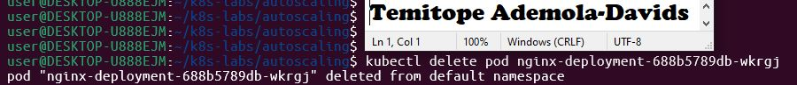

---

#### Screenshot 5 — Output of `kubectl get pods` showing the replacement Pod and two running Pods

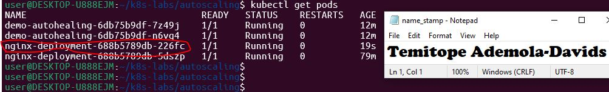

---

### Notes

**1. What happened after you deleted one Pod?**

The Kubernetes deployment controller immediately detected that the active pod count dropped below the desired specification of two replicas and automatically triggered the creation of a brand new replacement pod

---

**2. What Kubernetes resource maintains the desired replica count for this Deployment?**

The Deployment controller (acting through its underlying ReplicaSet) continuously monitors cluster state and maintains the desired replica count.

---

**3. What proves that auto-healing worked?**

The active pod count successfully returned to two running instances, and a new pod with a distinct name/suffix was automatically provisioned and reached the ready state without manual intervention
---

# Task 3 — Create a Deployment for HPA

## Goal

Create a Deployment with CPU resource requests and limits so that HPA can calculate CPU utilization.

### Evidence

#### Screenshot 6 — Completed `hpa-deployment.yaml` manifest showing CPU requests and limits

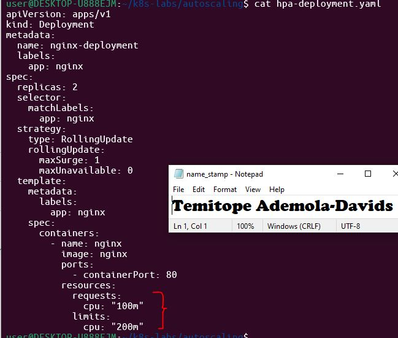

---

#### Screenshot 7 — Output showing `nginx-deployment` and its running Pods

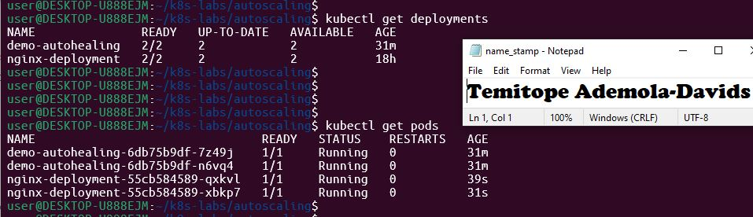

---

### Notes

**1. What does `cpu: "100m"` mean?**

It represents 100 millicores (or 0.1 of a CPU core), which is the guaranteed minimum CPU resource allocated to the container.

---

**2. What is the difference between a CPU request and a CPU limit?**

A CPU request is the guaranteed amount of CPU allocated to the container when it runs, used by Kubernetes for scheduling. A CPU limit is the maximum amount of CPU the container is allowed to consume on the node.

---

**3. Why does CPU-based HPA require CPU requests?**

The HPA calculates CPU utilization as a percentage of the requested CPU (Current CPU Usage 
÷
 Requested CPU). Without a defined CPU request, the autoscaler cannot determine the baseline capacity against which to measure utilization.
---

# Task 4 — Enable and Verify Metrics Server

## Goal

Ensure the cluster can collect resource metrics for the HPA.

### Evidence

#### Screenshot 8 — Output showing Metrics Server running, or `kubectl top pods` displaying Pod metrics

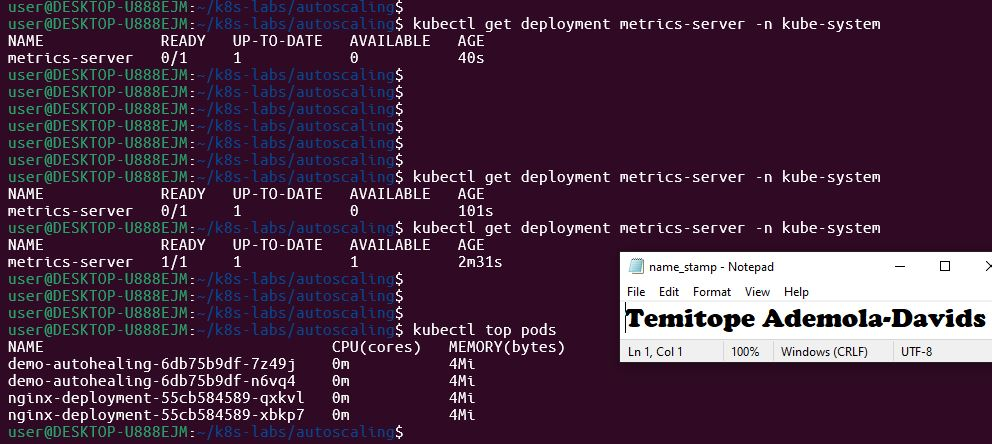

---

### Notes

**1. Why does HPA need Metrics Server?**

The HPA relies on the Metrics Server to gather real-time resource utilization metrics (such as CPU and memory usage) for pods. Without these metrics, the autoscaler cannot evaluate whether scaling thresholds have been exceeded.

---

**2. What issue can occur if Metrics Server is not working?**

The HPA will be unable to fetch usage data, resulting in unknown or missing utilization metrics (often shown as in kubectl get hpa), preventing the autoscaler from scaling the deployment up or down.

---

**3. What does `kubectl top pods` help you check?**

It provides a real-time snapshot of actual CPU and memory consumption across your active pods, helping you verify that resource usage reporting is functioning correctly.

---

# Task 5 — Create a Horizontal Pod Autoscaler

## Goal

Create an HPA that keeps at least two Pods running and can scale up to five Pods when average CPU utilization exceeds 50%.

### Evidence

#### Screenshot 9 — The imperative command output OR completed `hpa-nginx.yaml` manifest

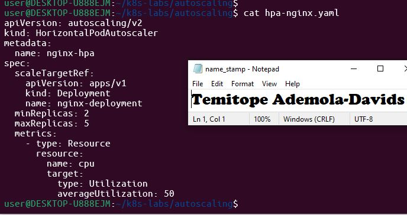

---

#### Screenshot 10 — Output of `kubectl get hpa` and the relevant `kubectl describe hpa` command

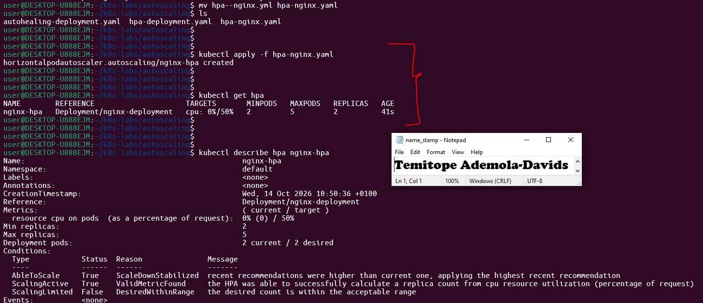

---

### Notes

**1. What does `minReplicas: 2` mean?**

It ensures that the Horizontal Pod Autoscaler will never scale the deployment down below 2 pods, maintaining a baseline capacity for availability and traffic load.

---

**2. What does `maxReplicas: 5` mean?**

It sets the upper limit on scaling, ensuring the autoscaler cannot provision more than 5 pod replicas regardless of how high CPU utilization climbs, protecting cluster resources.

---

**3. What does `averageUtilization: 50` mean?**

It specifies the target threshold (50% of the requested CPU) that triggers scaling actions. If the average CPU usage across pods exceeds 50% of their requested allocation, the HPA will scale up replicas.

---

**4. Why should only one HPA manage a Deployment at a time?**

Multiple autoscalers targeting the same deployment would issue conflicting scaling commands (e.g., one trying to scale up while another scales down), leading to instability, thrashing, and unpredictable replica counts.

---

# Task 6 — Optional: Generate CPU Load and Observe Scaling

## Goal

Generate CPU load in one NGINX Pod and observe how HPA responds.

### Evidence

If you skip this task, write “Not completed — optional” and leave the remaining Task 6 placeholders blank.

Task status: Add your status here.

#### Screenshot 11 — Terminal showing the CPU-load command running inside the selected Pod

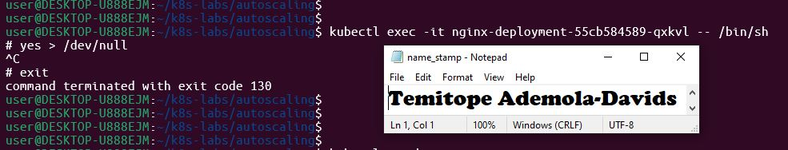

---

#### Screenshot 12 — Output of `kubectl get hpa` and `kubectl get pods` while HPA evaluates or changes the replica count

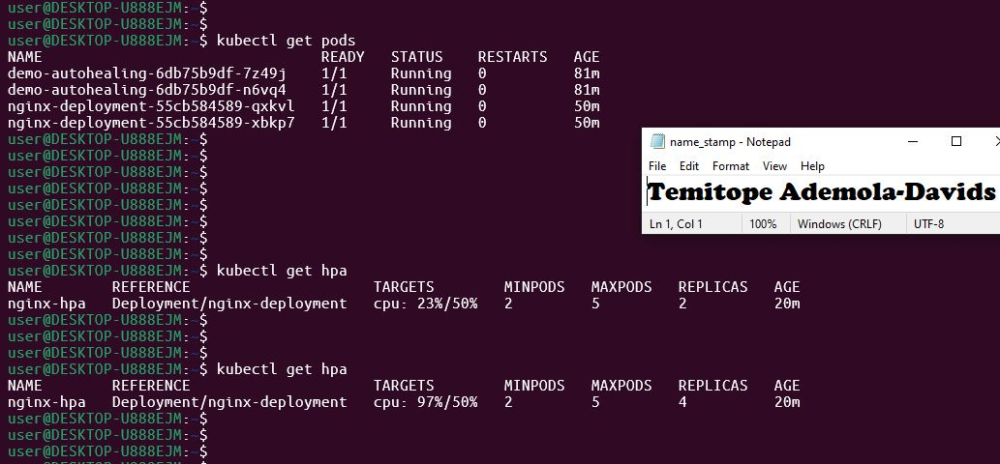

---

### Notes

Complete these answers only if you perform the optional test.

**1. Did the HPA change the number of Pods? Explain what you observed.**

Yes. Once the load generator increased CPU utilization above the 50% target threshold, the HPA automatically triggered a scale-up event, increasing the replica count of nginx-deployment to handle the incoming traffic load.

---

**2. If scaling did not happen, what are two possible reasons?**

Not applicable scaling occurred. (Alternatively: Insufficient time for metrics aggregation, or CPU requests/limits not being properly configured on the container).

---

**3. Why is automatic scale-down useful after traffic decreases?**

It ensures efficient utilization of cluster resources and reduces infrastructure compute costs by automatically releasing unneeded pod replicas when peak traffic subsides.

---

# LinkedIn Requirement

### Evidence

#### Screenshot 13 — Published LinkedIn post showing your name, the required explanation, and the attached Kubernetes screenshot

Add your screenshot here.

#### Linkedin Post Link

Add your link here

---

# Submission Instructions

- Include required Screenshots 1–10 and Screenshot 13.
- Include Screenshots 11–12 only if you complete Task 6.
- Full Name must be visible in required screenshots.
- Ensure screenshots are clear and readable.
- Include the completed `autohealing-deployment.yaml` and `hpa-deployment.yaml` files.
- Include `hpa-nginx.yaml` if you selected the declarative HPA method.
- Complete the Notes sections for Tasks 1–5 in your own words.
- Complete Task 6 notes only if you perform the optional test.
- Do not expose passwords, tokens, private keys, kubeconfig files, or account IDs.

---

# Completion Checklist

- [ ] Checked the active context and existing cluster resources
- [ ] Created the autoscaling working directory (Screenshot 1)
- [ ] Created `autohealing-deployment.yaml` (Screenshot 2)
- [ ] Confirmed two auto-healing Pods were running (Screenshot 3)
- [ ] Deleted one managed Pod (Screenshot 4)
- [ ] Confirmed that the Pod was automatically replaced (Screenshot 5)
- [ ] Created `hpa-deployment.yaml` with CPU requests and limits (Screenshot 6)
- [ ] Verified `nginx-deployment` and its running Pods (Screenshot 7)
- [ ] Verified Metrics Server and confirmed Pod metrics are available (Screenshot 8)
- [ ] Created one HPA using the selected method (Screenshot 9)
- [ ] Verified minimum replicas of 2, maximum replicas of 5, and a CPU target of 50% (Screenshot 10)
- [ ] Completed Notes for Tasks 1–5
- [ ] Completed Task 6 evidence and notes, or marked it “Not completed — optional”
- [ ] Stopped the CPU-load command and exited the container shell, if Task 6 was completed
- [ ] Published the LinkedIn post with the required explanation and attached screenshot (Screenshot 13)
- [ ] Included the required manifest files
- [ ] No sensitive data exposed

---

## 📌 About DMI & CloudAdvisory

DevOps Micro Internship (DMI) is a project-based DevOps program run by Pravin Mishra (The CloudAdvisory) focused on real-world execution, systems thinking, and career readiness.

It helps learners build strong DevOps foundations with hands-on experience.

---

## 📌 Resources

- 🌐 DMI Official Website: https://dmi.pravinmishra.com?utm_source=github&utm_medium=readme  
- 🎓 University: https://university.pravinmishra.com?utm_source=github&utm_medium=readme  
- 💬 Discord Community: https://discord.pravinmishra.com?utm_source=github&utm_medium=readme  
- 📝 Blog: https://dmi.pravinmishra.com/blog?utm_source=github&utm_medium=readme  
- ▶️ YouTube Playlist: https://www.youtube.com/playlist?list=PLFeSNDtI4Cho  
- 🔗 Pravin Mishra (LinkedIn): https://www.linkedin.com/in/pravin-mishra-aws-trainer/  
- 🏢 CloudAdvisory (LinkedIn): https://www.linkedin.com/company/thecloudadvisory/

---

*This submission is part of DevOps Micro Internship (DMI) — Agentic AI Track.*
