# Assignment 5 — Kubernetes Health Probes (Readiness)

Part of the DevOps Micro Internship (DMI) with Agentic AI

---

## Purpose

In this assignment, you will configure and test a Kubernetes readiness probe. You will create a baseline NGINX Deployment, add an HTTP readiness probe, intentionally break it, observe a stalled rollout, and restore the working configuration.

You will also demonstrate how readiness probes protect rolling updates.

---

# Task 0 — Prepare the Lab Environment

## Goal

Confirm that you are connected to your learning cluster and remove the previous assignment’s HPA and NGINX Deployment before starting this lab.

No screenshot or written notes are required for this pre-check.

---

# Task 1 — Set Up Your Lab Directory

## Goal

Create and enter a dedicated directory for the readiness-probe lab.

### Evidence

#### Screenshot 1 — Terminal showing that you are working inside `~/k8s-labs/health-probes-readiness`

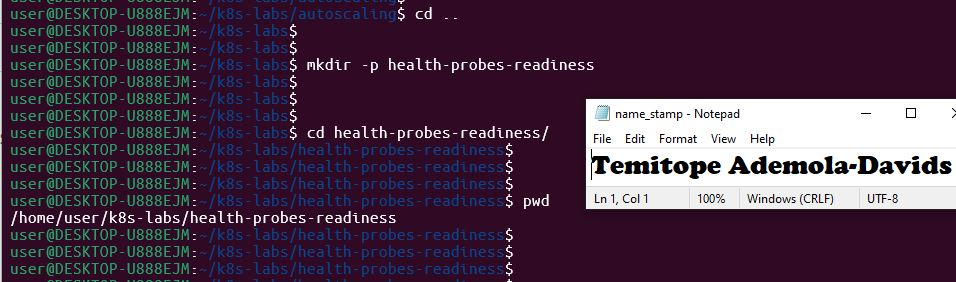

---

### Notes

**1. What is the purpose of a readiness probe?**

A readiness probe determines whether a container is ready to accept network traffic. If the readiness probe fails, Kubernetes removes the pod's IP address from the endpoints of all matching services so no traffic is routed to it until it recovers.

**2. Why is a Pod being Running not always enough to confirm it can serve traffic?**

A pod can be in a Running state because its containers have started up, but the application inside may still be loading data, warming caches, establishing database connections, or failing internal health checks. A readiness probe verifies that the application is fully initialized and actually ready to handle client requests.

---

# Task 2 — Create a Baseline Deployment Without Probes

## Goal

Create a baseline NGINX Deployment with two replicas and no readiness probe.

### Evidence

#### Screenshot 2 — Completed `00-nginx-deploy-baseline.yaml` manifest

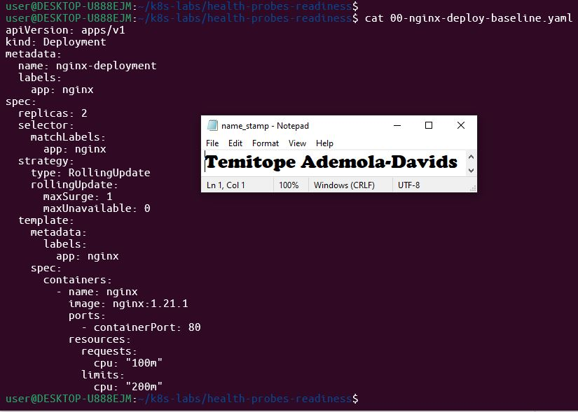

---

#### Screenshot 3 — Output showing a successful rollout and two running NGINX Pods

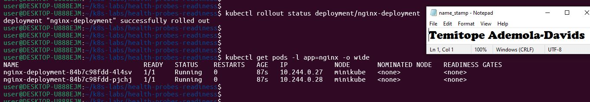

---

#### Screenshot 4 — Relevant output from `kubectl describe deployment nginx-deployment`

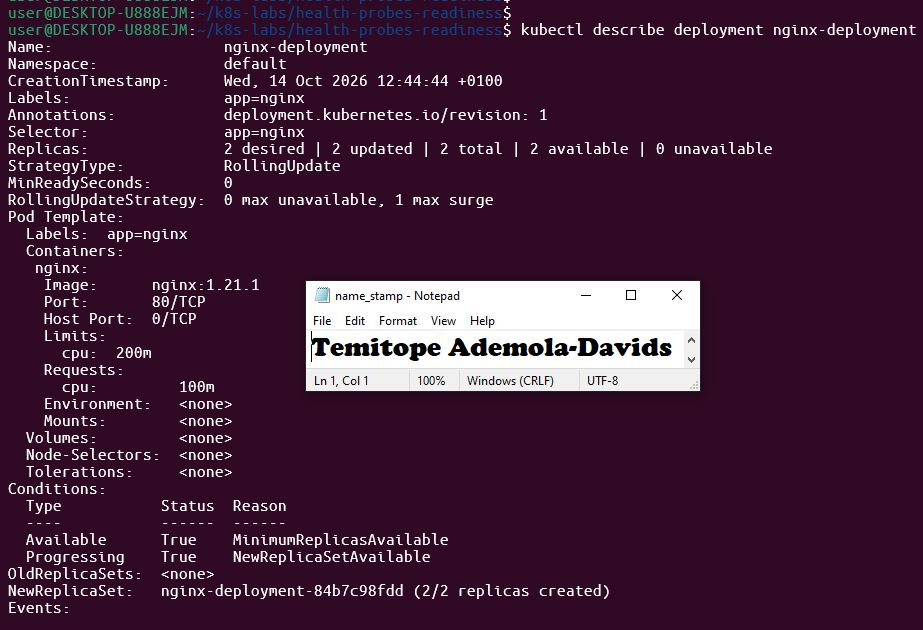

---

### Notes

**1. How many replicas does this Deployment maintain?**

It keeps 2 replicas

**2. What does `maxUnavailable: 0` mean during a rolling update?**

It ensures that zero existing pods can be taken offline during an update, meaning the cluster must provision new pods (maxSurge: 1) before terminating old ones to maintain full desired capacity

**3. Is a readiness probe configured in this baseline Deployment?**

No, there are no readiness probes or liveness defined in the baseline config.

---

# Task 3 — Add a Readiness Probe

## Goal

Add an HTTP readiness probe so Kubernetes checks whether each NGINX container is ready to accept requests.

### Evidence

#### Screenshot 5 — Completed `01-nginx-deploy-readiness.yaml` manifest showing the readiness probe

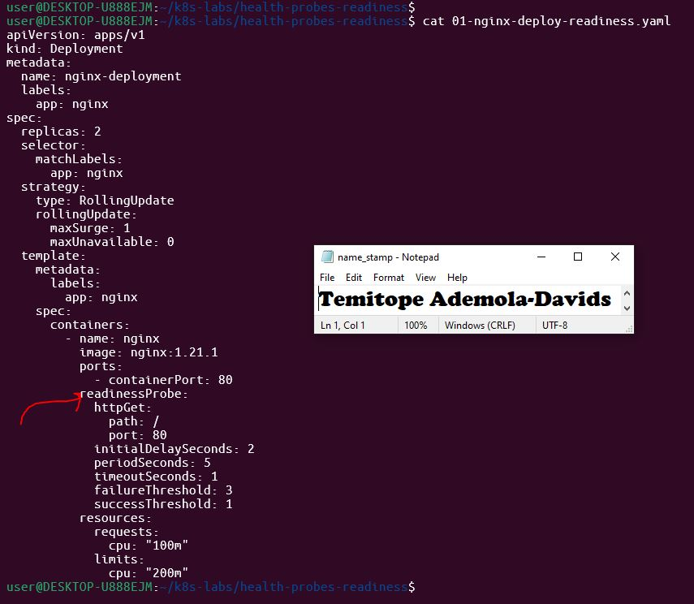

---

#### Screenshot 6 — Output of the successful rollout and ready Pods

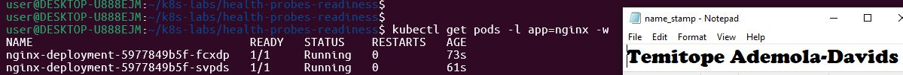

---

#### Screenshot 7 — Pod description showing readiness conditions and readiness probe details

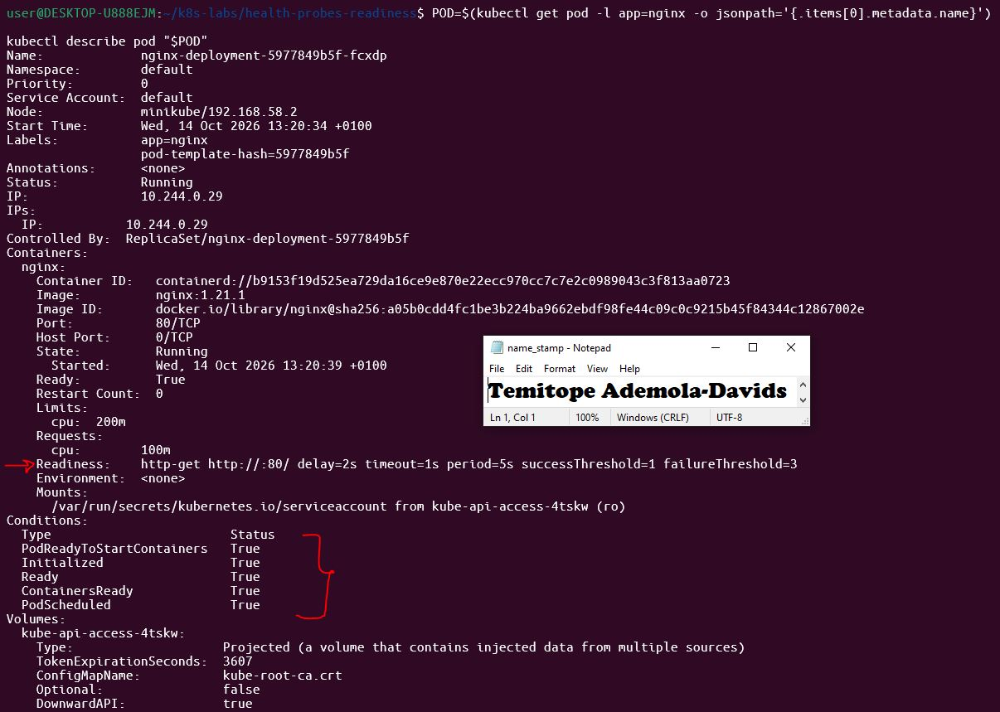

---

### Notes

**1. What path and port does the readiness probe check?**

It checks path / on port 80.

**2. What does `initialDelaySeconds: 2` do?**

It waits for 2 seconds after the container starts before initiating the first readiness probe check, giving the application time to initialize.

**3. What does `periodSeconds: 5` do?**

It specifies that Kubernetes will perform the readiness probe check every 5 seconds.

**4. What must happen before Kubernetes considers this Pod ready?**

The container must successfully respond to the HTTP GET request on path / at port 80 with a successful HTTP status code (typically between 200 and 399).

---

# Task 4 — Break and Restore Readiness

## Goal

Intentionally fail the readiness probe, observe the NotReady behavior, and then restore the working probe configuration.

### Evidence

#### Screenshot 8 — `02-nginx-readiness-broken.yaml` showing `/does-not-exist`

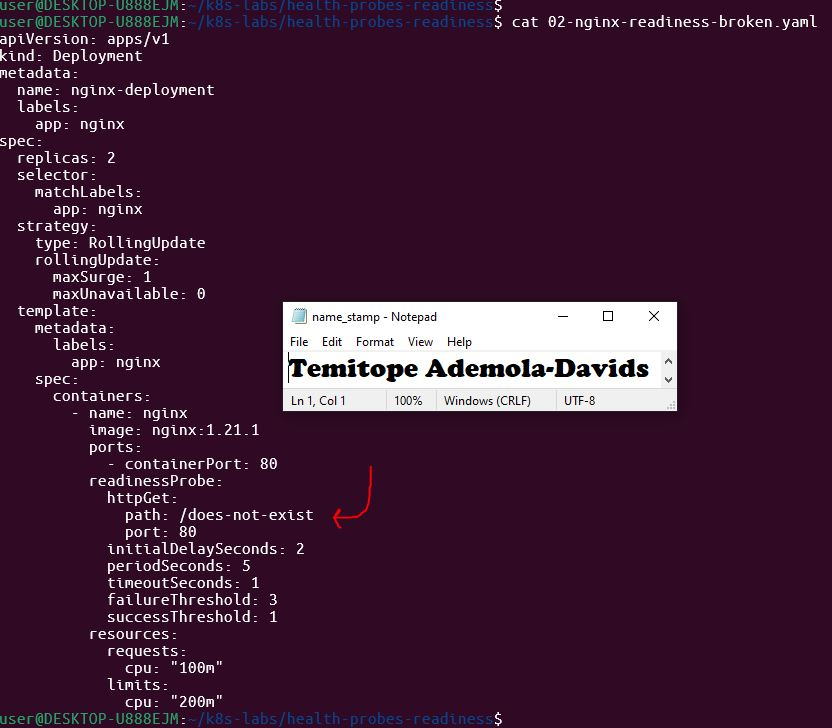

---

#### Screenshot 9 — Output showing the rollout timeout or incomplete rollout

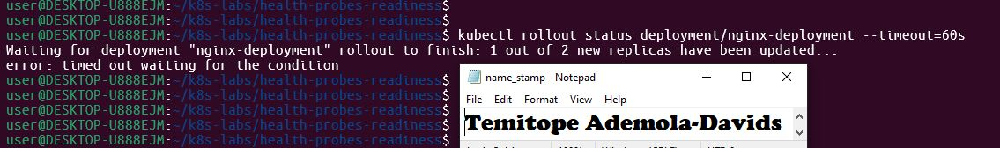

---

#### Screenshot 10 — Pod details showing `Ready: False` or readiness-probe failure events

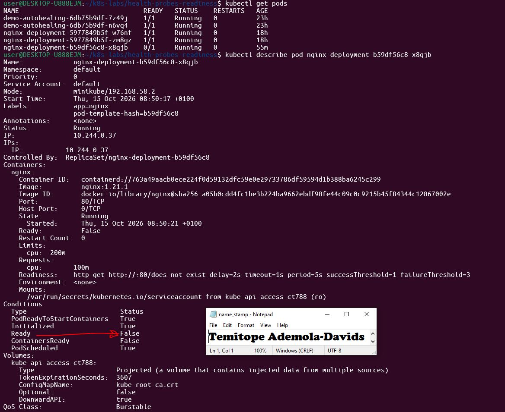

---

#### Screenshot 11 — Output showing successful rollout and ready Pods after the fix

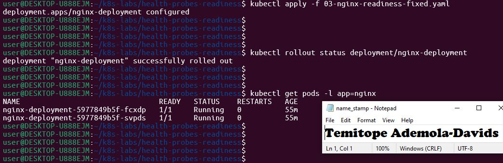

---

### Notes

**1. Why did the readiness probe fail?**

The readiness probe was configured with an invalid path (/does-not-exist), which caused the NGINX web server to return an HTTP 404 Not Found status code instead of a successful response code between 200 and 399.

**2. What happened to the Pod readiness status?**

The Pod readiness status changed from True to False because the container failed its configured health checks.

**3. Why did the rollout fail to complete?**

It was because the deployment specifies maxUnavailable: 0, Kubernetes cannot terminate existing healthy pods until the new replacement pods achieve a Ready status. Since the new pods failed their probes, they remained NotReady, stalling the rollout.

**4. How did you restore the Deployment successfully?**

By re-applying the original working manifest (01-nginx-deploy-readiness.yaml) which corrected the readiness probe path back to /, allowing new pods to pass their checks and complete the rolling update.

---

# Task 5 — See How Readiness Protects Rolling Updates

## Goal

Observe how readiness prevents a bad new Pod from replacing healthy Pods during a rolling update.

### Evidence

#### Screenshot 12 — Successful update command and rollout status

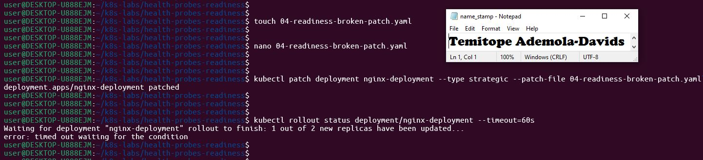

---

#### Screenshot 13 — ReplicaSets and Pods after the successful rolling update

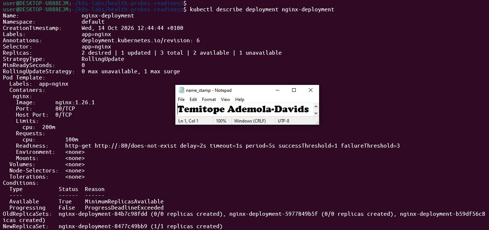

---

#### Screenshot 14 — Completed `04-readiness-broken-patch.yaml`

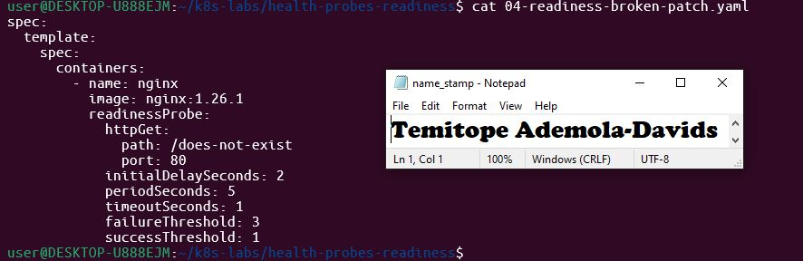

---

#### Screenshot 15 — Output showing the expected stalled rollout or timeout

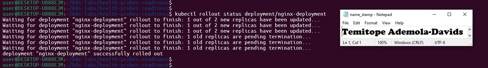

---

#### Screenshot 16 — Deployment or Pod output showing the effect of the broken readiness probe

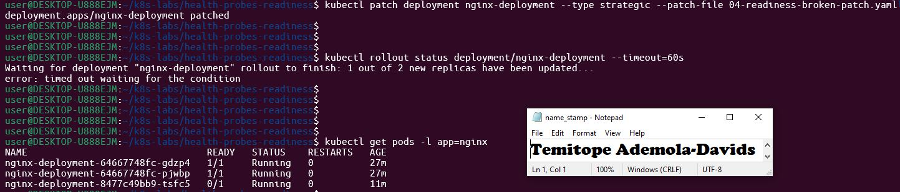

---

#### Screenshot 17 — Successful rollout status after restoring the fixed configuration

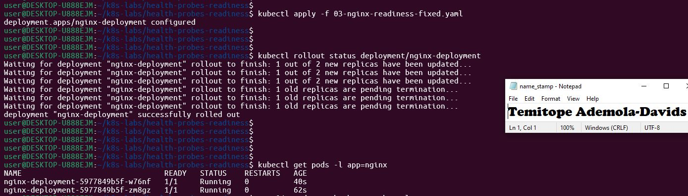

---

### Notes

**1. What happened during the successful rolling update?**

New pods were created and verified as ready before old pods were terminated, ensuring zero downtime and continuous traffic availability.

**2. Why did Kubernetes create a new ReplicaSet?**

Kubernetes creates a new ReplicaSet whenever a Deployment's pod template specification changes, managing the lifecycle of the new revision separately from the old one.

**3. Why were the new Pods unable to replace the existing healthy Pods after readiness was broken?**

Because their readiness probes failed, preventing them from achieving a Ready state. Since maxUnavailable: 0 was set, Kubernetes refused to terminate the old healthy pods.

**4. How does `maxUnavailable: 0` protect availability during this rollout?**

It enforces zero operational capacity taken offline during an update, preventing faulty code or misconfis from causing downtime.

---

# Task 6 — Share Your Readiness-Probe Learning on LinkedIn

## Goal

Share what you learned about Kubernetes readiness probes and how they protect rolling updates.

### Evidence

#### Screenshot 18 — Published LinkedIn post

Add your screenshot here.

#### Linkedin post link

Add your post link here

---

# Submission Instructions

- Add all required screenshots numbered 1–18.
- Ensure your full name is visible in required screenshots.
- Use clear, readable screenshots showing the relevant manifest or output.
- Include the completed baseline and readiness-probe manifests in your repository.
- Answer all Notes questions for Tasks 1–5 in your own words.
- Include evidence of the intentional readiness failure and successful recovery.
- Do not expose tokens, passwords, kubeconfig files, account IDs, or other sensitive information.

---

# Completion Checklist

- [ ] Learning cluster confirmed and previous assignment resources removed where applicable
- [ ] Readiness-probe lab directory created (Screenshot 1)
- [ ] Baseline Deployment created successfully (Screenshot 2)
- [ ] Two baseline Pods running and successful rollout verified (Screenshot 3)
- [ ] Baseline Deployment details reviewed (Screenshot 4)
- [ ] Readiness probe added successfully (Screenshot 5)
- [ ] Successful readiness rollout verified (Screenshot 6)
- [ ] Pod readiness conditions and probe details inspected (Screenshot 7)
- [ ] Broken readiness configuration created (Screenshot 8)
- [ ] Stalled rollout or timeout observed (Screenshot 9)
- [ ] NotReady status or readiness-probe failure events captured (Screenshot 10)
- [ ] Working readiness configuration restored (Screenshot 11)
- [ ] Successful image update completed (Screenshot 12)
- [ ] ReplicaSets and Pods inspected after the update (Screenshot 13)
- [ ] Broken-readiness patch created (Screenshot 14)
- [ ] Stalled rollout observed after the patch (Screenshot 15)
- [ ] Effect of broken readiness captured (Screenshot 16)
- [ ] Final recovery completed (Screenshot 17)
- [ ] LinkedIn post published (Screenshot 18)
- [ ] Notes for Tasks 1–5 completed
- [ ] Required manifests included
- [ ] All screenshots are clear and readable
- [ ] No sensitive data exposed

---

## 📌 About DMI & CloudAdvisory

DevOps Micro Internship (DMI) is a project-based DevOps program run by Pravin Mishra (The CloudAdvisory) focused on real-world execution, systems thinking, and career readiness.

It helps learners build strong DevOps foundations with hands-on experience.

---

## 📌 Resources

- 🌐 DMI Official Website: https://dmi.pravinmishra.com?utm_source=github&utm_medium=readme  
- 🎓 University: https://university.pravinmishra.com?utm_source=github&utm_medium=readme  
- 💬 Discord Community: https://discord.pravinmishra.com?utm_source=github&utm_medium=readme  
- 📝 Blog: https://dmi.pravinmishra.com/blog?utm_source=github&utm_medium=readme  
- ▶️ YouTube Playlist: https://www.youtube.com/playlist?list=PLFeSNDtI4Cho  
- 🔗 Pravin Mishra (LinkedIn): https://www.linkedin.com/in/pravin-mishra-aws-trainer/  
- 🏢 CloudAdvisory (LinkedIn): https://www.linkedin.com/company/thecloudadvisory/

---

*This submission is part of DevOps Micro Internship (DMI) — Agentic AI Track.*
