# Assignment 6 — Kubernetes Health Probes (Liveness)

Part of the DevOps Micro Internship (DMI) with Agentic AI

---

## Purpose

In this assignment, you will configure and test a Kubernetes liveness probe. You will create a baseline NGINX Deployment, add an HTTP liveness probe, intentionally make it fail, observe container restarts, and restore the working configuration.

---

# Task 0 — Prepare the Lab Environment

## Goal

Confirm that you are connected to your learning cluster and remove the previous HPA and NGINX Deployment before starting this lab.

No screenshot or written notes are required for this pre-check.

---

# Task 1 — Set Up Your Lab Directory

## Goal

Create and enter a dedicated directory for the liveness-probe lab.

### Evidence

#### Screenshot 1 — Terminal showing that you are working inside `~/k8s-labs/health-probes-liveness`

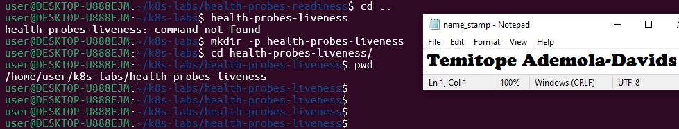

---

### Notes

**1. What problem does a liveness probe solve?**

A liveness probe detects when an application inside a container enters a deadlocked, frozen, or unresponsive state (even if the container process itself is still running) and automatically restarts the container to restore service health.

**2. What is the key difference between a readiness probe and a liveness probe?**

A readiness probe determines whether a Pod is ready to accept network traffic (marking it NotReady and removing it from Service endpoints if it fails). A liveness probe determines whether the container needs to be restarted due to an internal failure or crash.

---

# Task 2 — Create a Baseline Deployment Without Probes

## Goal

Create a baseline NGINX Deployment with two replicas and no health probes.

### Evidence

#### Screenshot 2 — Completed `00-nginx-deploy-baseline.yaml` manifest

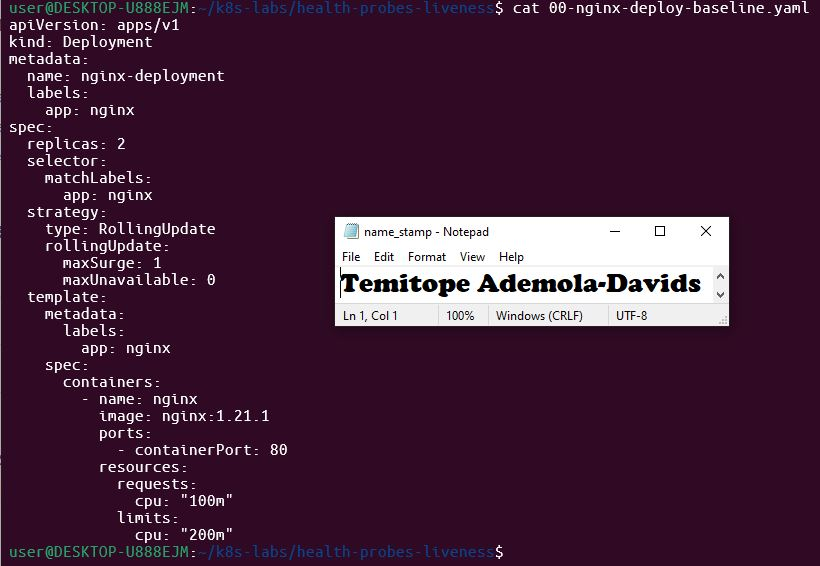

---

#### Screenshot 3 — Output showing a successful rollout and two running NGINX Pods

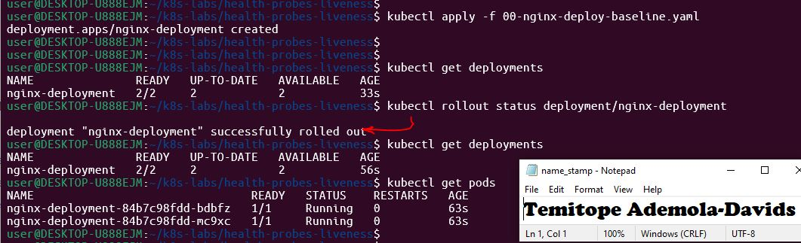

---

#### Screenshot 4 — Relevant output from `kubectl describe deployment nginx-deployment`

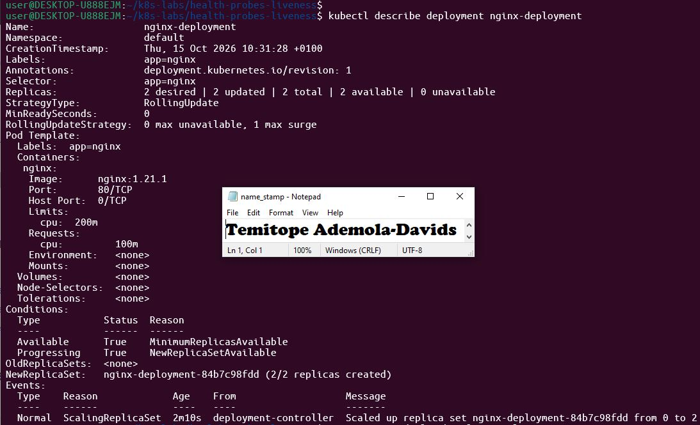

---

### Notes

**1. How many replicas does this Deployment maintain?**

It has 2 replicas

**2. Are any health probes configured in the baseline Deployment?**

None, neither liveness probe or readiness probes are configured.

**3. Why is a baseline useful before adding a liveness probe?**

It establishes a known working state so you can confirm that your base application functions correctly before introducing health checking logic.
---

# Task 3 — Add a Liveness Probe

## Goal

Add an HTTP liveness probe so Kubernetes can periodically check whether the NGINX container is still responsive.

### Evidence

#### Screenshot 5 — Completed `01-nginx-deploy-liveness.yaml` manifest showing the liveness probe

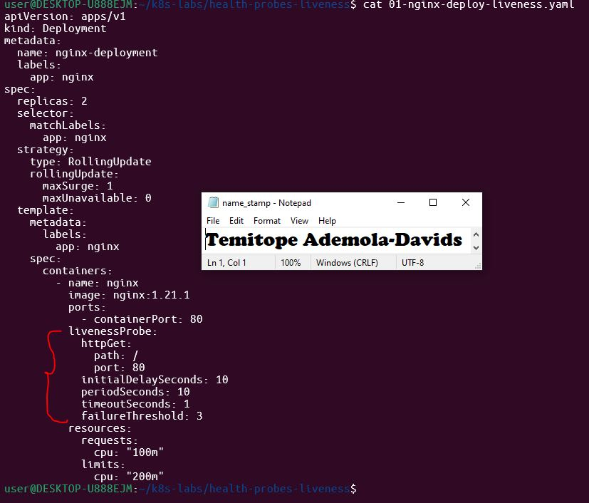

---

#### Screenshot 6 — Output showing successful rollout and running Pods

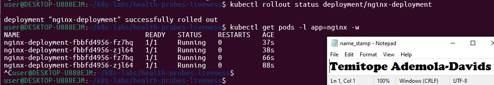

---

#### Screenshot 7 — Pod description showing liveness-probe details

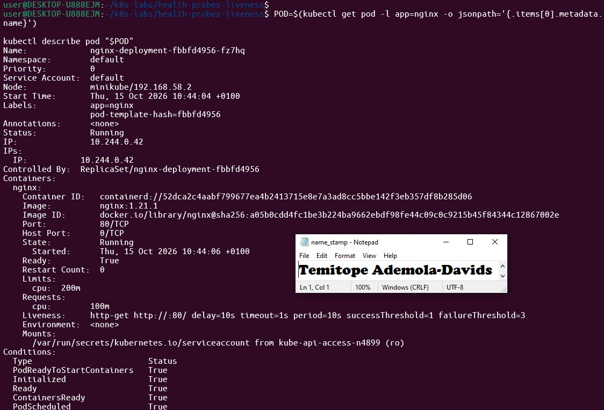

---

### Notes

**1. What path and port does the liveness probe check?**

Path / on port 80.

**2. What does `initialDelaySeconds: 10` do?**

It instructs Kubernetes to wait 10 seconds after the container starts up before performing the first liveness probe.

**3. What does `failureThreshold: 3` mean?**

It specifies that Kubernetes will allow 3 consecutive probe failures before deciding to kill and restart the container.

**4. Does a successful liveness probe control whether a Pod receives traffic? Explain briefly.**

No. Liveness probes only manage container restarts upon failure. Readiness probes control whether a Pod receives network traffic.

---

# Task 4 — Trigger and Observe a Liveness Restart

## Goal

Intentionally make the liveness probe fail and observe Kubernetes restart the unhealthy container.

### Evidence

#### Screenshot 8 — `02-nginx-liveness-broken.yaml` showing `/does-not-exist`

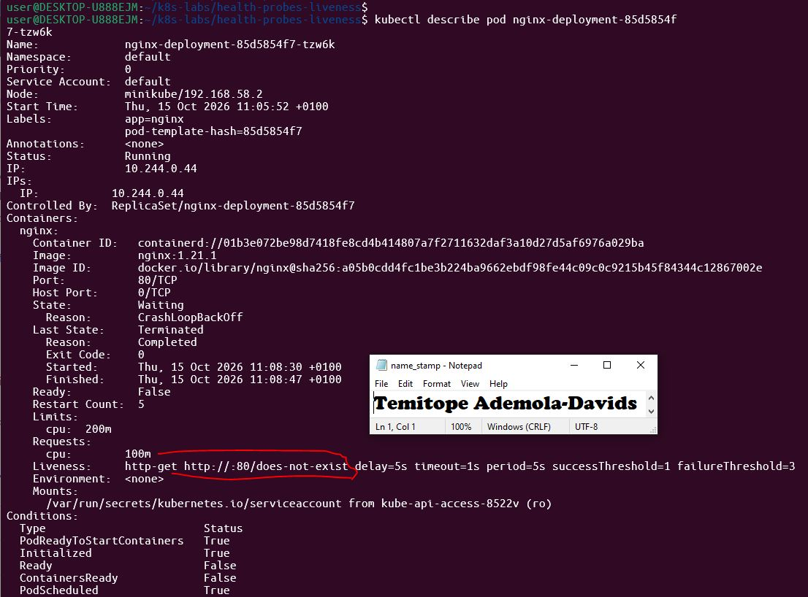

---

#### Screenshot 9 — Pod output showing an increased RESTARTS count

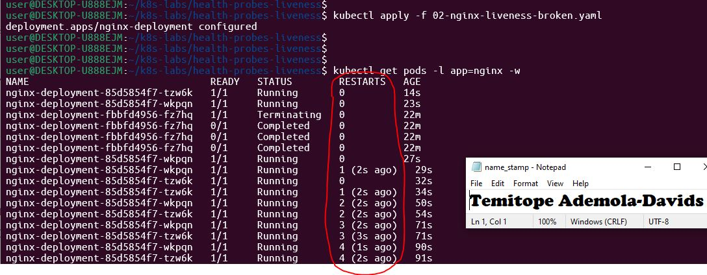

---

#### Screenshot 10 — Pod description showing liveness-probe failure events or restart details

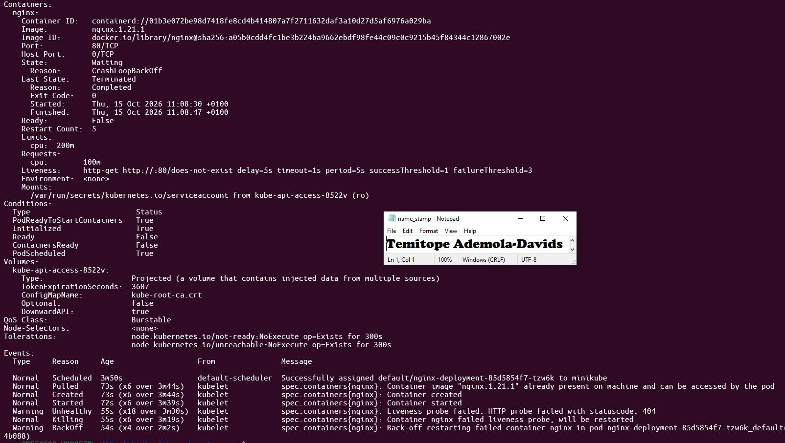

---

#### Screenshot 11 — Output showing stable running Pods after applying the fixed configuration

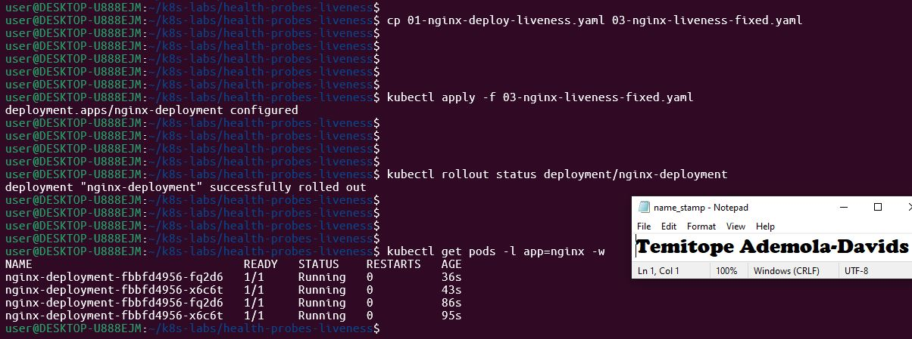

---

### Notes

**1. Why did the liveness probe fail?**

The NGINX web server returned an HTTP 404 Not Found error for the invalid path /does-not-exist.

**2. What happened after Kubernetes detected repeated liveness-probe failures?**

Kubernetes terminated the unhealthy container and automatically restarted a fresh container instance within the Pod

**3. What does the RESTARTS column prove?**

It tracks how many times the container has crashed or been restarted by Kubernetes due to failed health probes.

**4. How did you restore the Deployment to a stable state?**

By applying the fixed manifest (03-nginx-liveness-fixed.yaml) which restored the valid liveness probe path (/).

---

# Task 5 — Optional: Observe a Restart Loop

## Goal

Observe why overly aggressive or incorrectly configured liveness probes can create restart loops.

Complete this section only if you attempt Task 5. Otherwise, mark it as “Not attempted.”

**Task status:** Completed / Not attempted

### Evidence

#### Optional Screenshot — Pod output showing the RESTARTS count increasing during the restart-loop observation

Add your screenshot here if attempted.

No specific restart count or CrashLoopBackOff status is required.

---

### Notes — Answer Only If Attempted

**1. What is a restart loop?**

A continuous cycle where a container repeatedly fails its liveness check, gets restarted by Kubernetes, fails again upon startup, and is killed repeatedly

**2. Why can an aggressive liveness probe be harmful?**

Overly aggressive checks (short periods, low thresholds, or heavy operations) can overwhelm applications or trigger unnecessary restarts during temporary network or resource spikes.

**3. Why should liveness checks be lightweight and carefully tuned?**

Overly aggressive checks (short periods, low thresholds, or heavy operations) can overwhelm applications or trigger unnecessary restarts during temporary network or resource spikes.

---

# Task 6 — Share Your Liveness-Probe Learning on LinkedIn

## Goal

Share what you learned about Kubernetes liveness probes, container restarts, and the difference between readiness and liveness.

### Evidence

#### Screenshot 12 — Published LinkedIn post

Add your screenshot here.

#### Linkedin post URL

Add URl here

---

# Submission Instructions

- Add all required screenshots numbered 1–12.
- Include the optional Task 5 screenshot only if you attempt that task.
- Ensure your full name is visible in required screenshots.
- Use clear, readable screenshots showing the relevant manifest or output.
- Include the completed baseline and liveness-probe manifests in your repository.
- Answer all Notes questions for Tasks 1–4 in your own words.
- If you attempt Task 5, complete its Notes and restore the working configuration afterward.
- Do not expose tokens, passwords, kubeconfig files, account IDs, or other sensitive information.

---

# Completion Checklist

- [ ] Learning cluster confirmed and previous assignment resources removed where applicable
- [ ] Liveness-probe lab directory created (Screenshot 1)
- [ ] Baseline Deployment manifest completed (Screenshot 2)
- [ ] Successful rollout and two baseline Pods verified (Screenshot 3)
- [ ] Baseline Deployment details reviewed (Screenshot 4)
- [ ] Liveness probe added successfully (Screenshot 5)
- [ ] Successful liveness-probe rollout verified (Screenshot 6)
- [ ] Liveness-probe details inspected (Screenshot 7)
- [ ] Broken liveness configuration created (Screenshot 8)
- [ ] Increased container restart count observed (Screenshot 9)
- [ ] Liveness-probe failure events or restart details captured (Screenshot 10)
- [ ] Working liveness configuration restored and stable Pods verified (Screenshot 11)
- [ ] Optional Task 5 evidence and Notes completed, if attempted
- [ ] Working configuration restored after Task 5, if attempted
- [ ] LinkedIn post published (Screenshot 12)
- [ ] Notes for Tasks 1–4 completed
- [ ] Required manifests included
- [ ] All required screenshots are clear and readable
- [ ] No sensitive data exposed

---

## 📌 About DMI & CloudAdvisory

DevOps Micro Internship (DMI) is a project-based DevOps program run by Pravin Mishra (The CloudAdvisory) focused on real-world execution, systems thinking, and career readiness.

It helps learners build strong DevOps foundations with hands-on experience.

---

## 📌 Resources

- 🌐 DMI Official Website: https://dmi.pravinmishra.com?utm_source=github&utm_medium=readme  
- 🎓 University: https://university.pravinmishra.com?utm_source=github&utm_medium=readme  
- 💬 Discord Community: https://discord.pravinmishra.com?utm_source=github&utm_medium=readme  
- 📝 Blog: https://dmi.pravinmishra.com/blog?utm_source=github&utm_medium=readme  
- ▶️ YouTube Playlist: https://www.youtube.com/playlist?list=PLFeSNDtI4Cho  
- 🔗 Pravin Mishra (LinkedIn): https://www.linkedin.com/in/pravin-mishra-aws-trainer/  
- 🏢 CloudAdvisory (LinkedIn): https://www.linkedin.com/company/thecloudadvisory/

---

*This submission is part of DevOps Micro Internship (DMI) — Agentic AI Track.*
