# Assignment 7 — Kubernetes Services (ClusterIP)

Part of the DevOps Micro Internship (DMI) with Agentic AI

---

## Purpose

In this assignment, you will create and test a Kubernetes ClusterIP Service. You will connect it to a healthy NGINX Deployment, access it using DNS and its ClusterIP, break and restore its selector, and observe how readiness affects Service routing.

---

# Task 0 — Prepare the Lab Environment

## Goal

Confirm your learning-cluster context and remove previous lab resources where applicable before starting this assignment.

No screenshot or written notes are required for this pre-check.

---

# Task 1 — Set Up Your Lab Directory

## Goal

Create and enter a dedicated directory for the ClusterIP Service lab.

### Evidence

#### Screenshot 1 — Terminal showing that you are working inside `~/k8s-labs/services/clusterip`

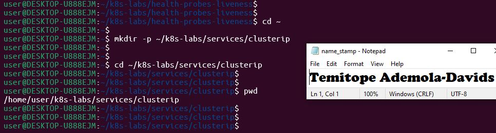

---

### Notes

**1. Why is it not reliable to communicate with an application using a Pod IP address?**

Pod IP addresses are temporal, ephemeral and change whenever a Pod is restarted, scaled, updated, or rescheduled.

**2. What Kubernetes resource provides a stable internal address for a group of Pods?**

Kubernetes Services

---

# Task 2 — Create a Healthy NGINX Deployment

## Goal

Create an NGINX Deployment with labels, readiness probes, and liveness probes that can act as the backend for a Service.

### Evidence

#### Screenshot 2 — Completed `00-nginx-deploy.yaml` manifest

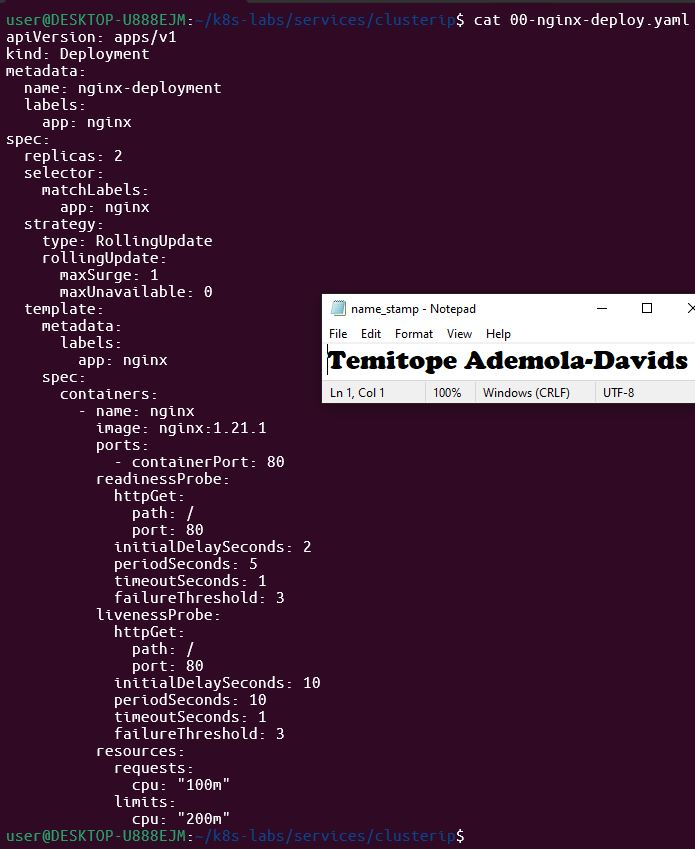

---

#### Screenshot 3 — Output showing successful rollout and two ready NGINX Pods

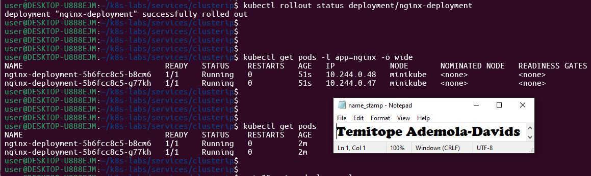

---

### Notes

**1. Which label will the Service use to find these Pods?**

app: nginx

**2. Why is readiness important before connecting Pods to a Service?**

It ensures that traffic is only routed to Pods that are fully initialized and capable of serving requests.

**3. What port does the NGINX container listen on?**

Port 80

---

# Task 3 — Create a ClusterIP Service

## Goal

Create a stable internal Service that routes traffic to the NGINX Pods.

### Evidence

#### Screenshot 4 — Completed `01-nginx-svc-clusterip.yaml` manifest

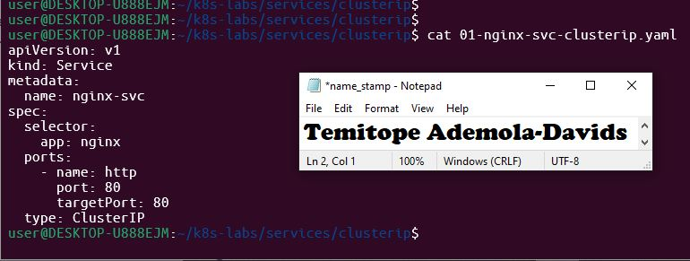

---

#### Screenshot 5 — Output showing the ClusterIP Service, endpoints, or EndpointSlices

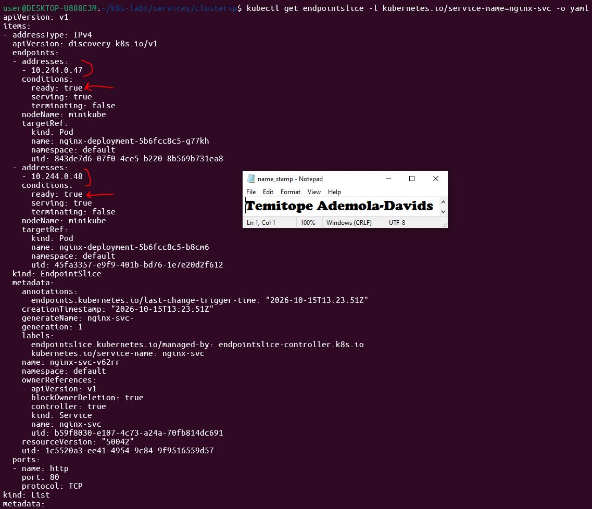

---

### Notes

**1. What is the purpose of a ClusterIP Service?**

It provides a stable internal IP address and load balancing across a set of Pods within the cluster.

**2. What is the difference between `port` and `targetPort`?**

port is the virtual port exposed by the Service itself, while targetPort is the port on the backend Pod container where traffic is forwarded.

**3. Why must the Service selector match the Pod labels?**

The Service uses the selector labels to dynamically discover and route traffic to the correct Pods

**4. What information do EndpointSlices contain?**

They contain backend Pod IP addresses, network ports, and readiness conditions.

---

# Task 4 — Access the Service from Inside the Cluster

## Goal

Create a client Pod and access the NGINX Service using DNS and its ClusterIP.

### Evidence

#### Screenshot 6 — Output showing the `tester` Pod running

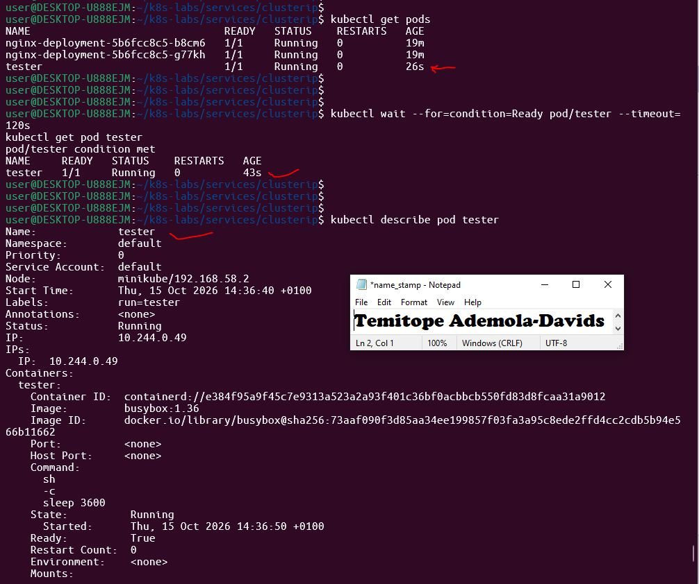

---

#### Screenshot 7 — Successful Service request using DNS name and ClusterIP

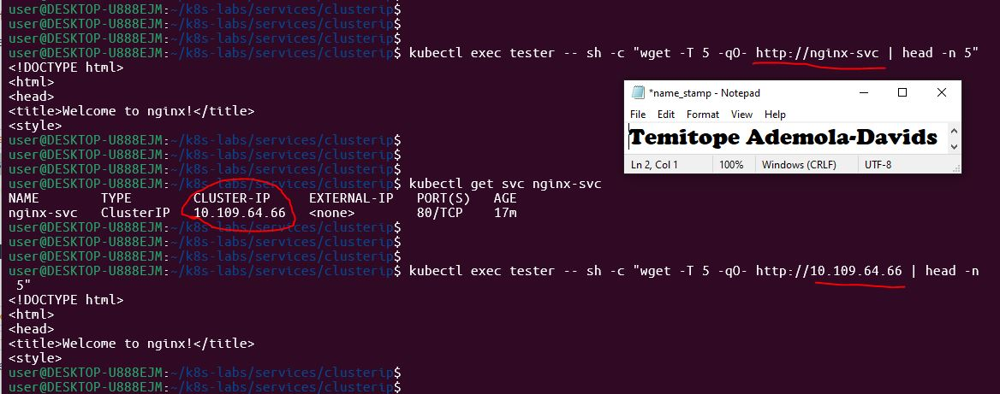

---

#### Screenshot 8 — Successful DNS lookup for the Service

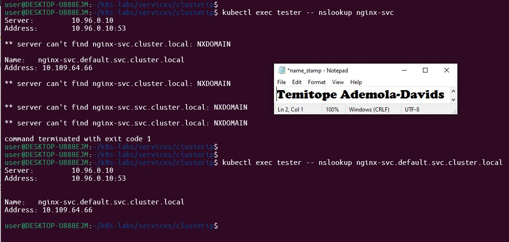

---

### Notes

**1. Why should an application use `nginx-svc` instead of a Pod IP address?**

It is because nginx-svc provides a stable address that persists even when backend Pod IPs change.

**2. What does the DNS name `nginx-svc.default.svc.cluster.local` represent?**

The fully qualified domain name (FQDN) of the Service within the default namespace and cluster domain.

**3. Why can the client access the Service even if the backend Pod IPs change?**

It is because the Service dynamically updates its endpoints via selectors and EndpointSlices to track healthy Pod IPs automatically.

---

# Task 5 — Break and Restore the Label-Selector Contract

## Goal

Break the Service selector, observe that usable endpoints disappear, and then restore the correct selector.

### Evidence

#### Screenshot 9 — `02-nginx-svc-selector-broken.yaml` showing the incorrect selector

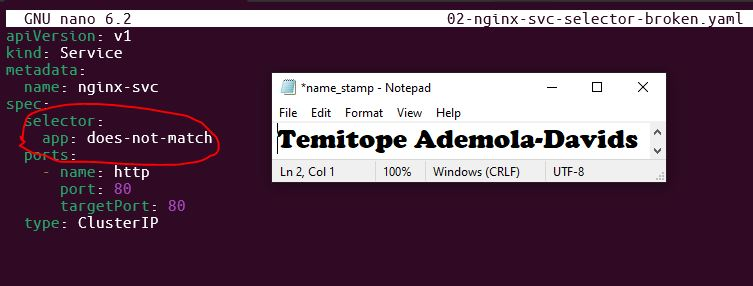

---

#### Screenshot 10 — Empty endpoints or EndpointSlice output after applying the broken selector

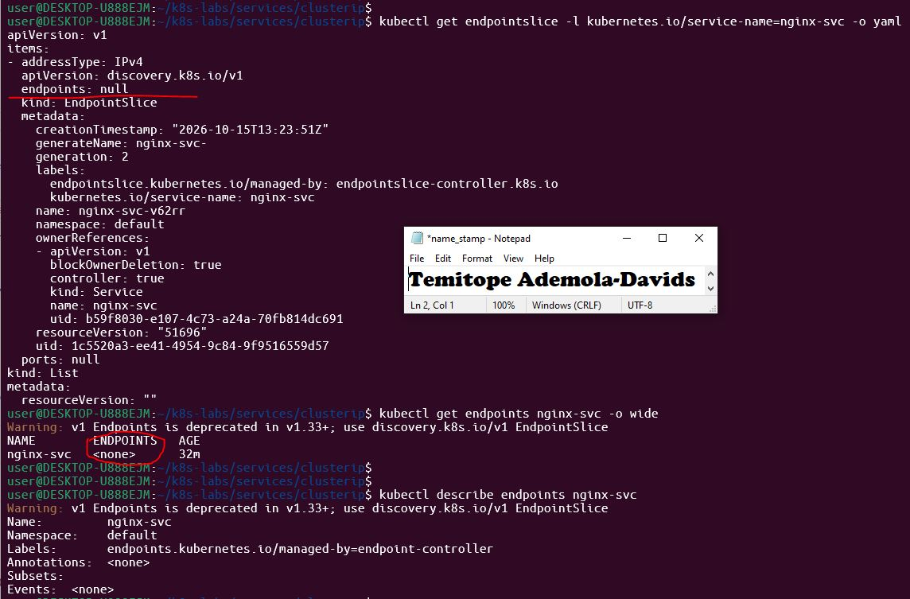

---

#### Screenshot 11 — Failed request output from the `tester` Pod

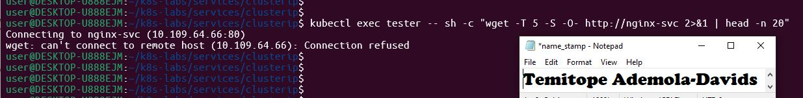

---

#### Screenshot 12 — Restored endpoints and successful Service request

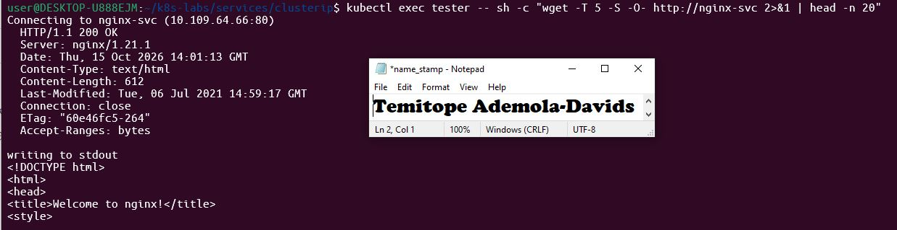

---

### Notes

**1. Why did the Service endpoints become empty?**

It is because no pods in the cluster matched the new swlwctor label app: does-not-match

**2. What caused the request from the client Pod to fail?**

The Service had no active backend endpoints to route the incoming traffic to.

**3. How did you restore connectivity to the NGINX Pods?**

By reapplying the original manifest (01-nginx-svc-clusterip.yaml) with the matching app: nginx selector.

---

# Task 6 — Observe How Readiness Affects Service Routing

## Goal

Observe how a new Pod that fails readiness is excluded from ready Service backends while the existing healthy Pod continues serving traffic.

### Evidence

#### Screenshot 13 — Output showing the Deployment scaled to one ready Pod

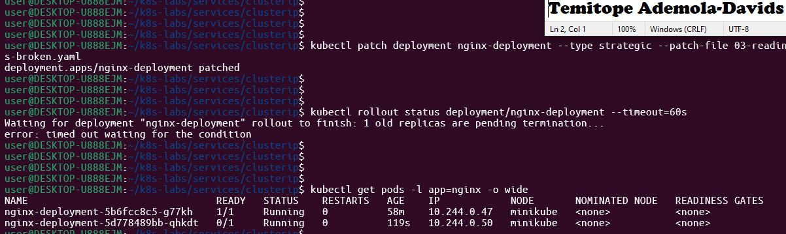

---

#### Screenshot 14 — Completed `03-readiness-broken.yaml` patch file

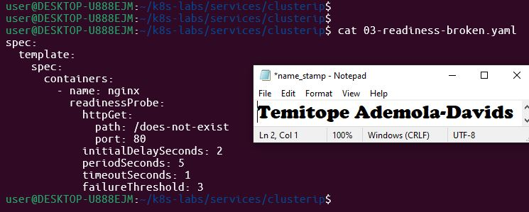

---

#### Screenshot 15 — Output showing the expected incomplete rollout or NotReady Pod

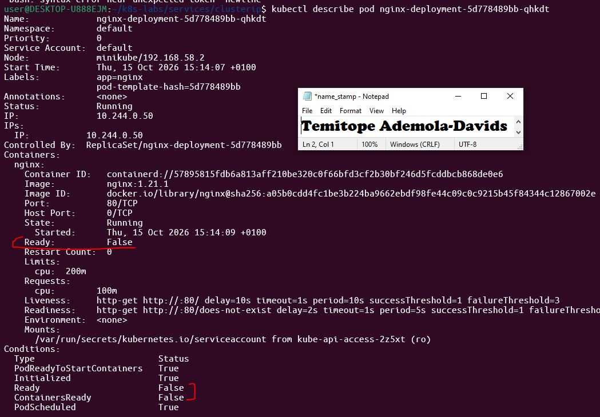

---

#### Screenshot 16 — EndpointSlice output showing the healthy Pod with `ready: true` and the new NotReady Pod with `ready: false`

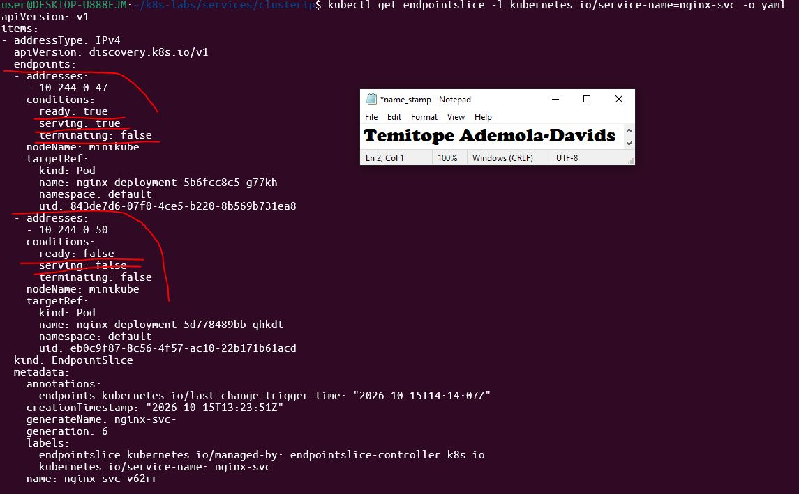

---

#### Screenshot 17 — Service EndpointSlice output showing ready backends after restoring the Deployment

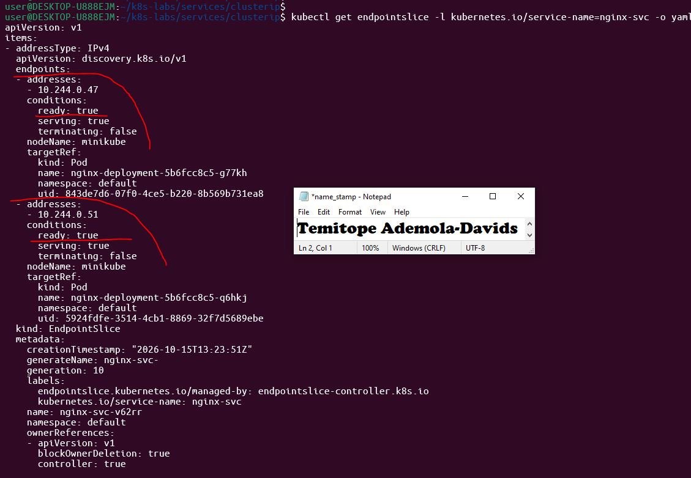

---

### Notes

**1. Why was the new NotReady Pod excluded from ready Service backends?**

It is because Kubernetes services only route traffic to endpoints whose readiness probe conditions report ready: true.

**2. What is the relationship between readiness probes and Service routing?**

Readiness probes directly control endpoint inclusion; unready pods are immediately removed from service EndpointSlices.

**3. Why does this behavior protect users from unhealthy application instances?**

It ensures that live client requests are never dispatched to crashing, starting, or failing container

---

# Task 7 — Share Your ClusterIP Service Learning on LinkedIn

## Goal

Share what you learned about ClusterIP Services, Kubernetes DNS, selectors, and readiness-aware Service routing.

### Evidence

#### Screenshot 18 — Published LinkedIn post

Add your screenshot here.

#### Linkedin post link

Paste your link here

---

# Submission Instructions

- Add all required screenshots numbered 1–18.
- Ensure your full name is visible in required screenshots.
- Use clear, readable screenshots showing the relevant manifest or output.
- Include the completed NGINX Deployment and ClusterIP Service manifests in your repository.
- Answer all Notes questions for Tasks 1–6 in your own words.
- Include evidence of the intentional failures and successful recovery.
- Do not expose tokens, passwords, kubeconfig files, account IDs, or other sensitive information.

---

# Completion Checklist

- [ ] Learning-cluster context confirmed and previous lab resources removed where applicable
- [ ] ClusterIP lab directory created (Screenshot 1)
- [ ] Healthy NGINX Deployment manifest completed (Screenshot 2)
- [ ] Successful rollout and two ready NGINX Pods verified (Screenshot 3)
- [ ] ClusterIP Service manifest completed (Screenshot 4)
- [ ] Service and backend endpoints or EndpointSlices verified (Screenshot 5)
- [ ] Client Pod created and running (Screenshot 6)
- [ ] Service accessed using DNS name and ClusterIP (Screenshot 7)
- [ ] Service DNS resolution verified (Screenshot 8)
- [ ] Broken selector manifest created (Screenshot 9)
- [ ] Empty endpoints observed (Screenshot 10)
- [ ] Failed Service request captured (Screenshot 11)
- [ ] Original selector restored and connectivity verified (Screenshot 12)
- [ ] Deployment scaled to one ready Pod (Screenshot 13)
- [ ] Broken readiness patch created (Screenshot 14)
- [ ] Incomplete rollout or NotReady Pod observed (Screenshot 15)
- [ ] Readiness effect on Service backends verified (Screenshot 16)
- [ ] Deployment restored and ready Service backends verified (Screenshot 17)
- [ ] LinkedIn post published (Screenshot 18)
- [ ] Notes for Tasks 1–6 completed
- [ ] Required manifests included
- [ ] All required screenshots are clear and readable
- [ ] No sensitive data exposed

---

## 📌 About DMI & CloudAdvisory

DevOps Micro Internship (DMI) is a project-based DevOps program run by Pravin Mishra (The CloudAdvisory) focused on real-world execution, systems thinking, and career readiness.

It helps learners build strong DevOps foundations with hands-on experience.

---

## 📌 Resources

- 🌐 DMI Official Website: https://dmi.pravinmishra.com?utm_source=github&utm_medium=readme  
- 🎓 University: https://university.pravinmishra.com?utm_source=github&utm_medium=readme  
- 💬 Discord Community: https://discord.pravinmishra.com?utm_source=github&utm_medium=readme  
- 📝 Blog: https://dmi.pravinmishra.com/blog?utm_source=github&utm_medium=readme  
- ▶️ YouTube Playlist: https://www.youtube.com/playlist?list=PLFeSNDtI4Cho  
- 🔗 Pravin Mishra (LinkedIn): https://www.linkedin.com/in/pravin-mishra-aws-trainer/  
- 🏢 CloudAdvisory (LinkedIn): https://www.linkedin.com/company/thecloudadvisory/

---

*This submission is part of DevOps Micro Internship (DMI) — Agentic AI Track.*
