# Assignment 8 — Kubernetes Services (NodePort)

Part of the DevOps Micro Internship (DMI) with Agentic AI

---

## Purpose

Create a healthy NGINX Deployment, expose it through a NodePort Service, test access using a node IP and NodePort, and observe how the Service behaves when a backend Pod is replaced.

---

# Task 1 — Set Up Your Lab Directory

## Goal

Create and enter a dedicated directory for the NodePort Service lab.

### Evidence

#### Screenshot 1 — Terminal showing that you are working inside `~/k8s-labs/services/nodeport`

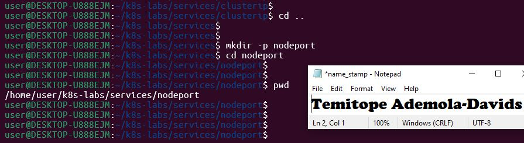

### Notes

**1. What is the difference between ClusterIP and NodePort?**

ClusterIP is the default Kubernetes Service type that exposes the service on an internal, cluster-scoped IP address. It is only reachable from within the cluster while

NodePort builds on top of ClusterIP by allocating a static port (typically in the 30000–32767 range) across every cluster node. Any traffic sent to : is automatically routed to the internal ClusterIP service and then to the backend Pods, enabling external traffic to enter the cluster.

**2. What does a NodePort Service allow users to do?**

A NodePort Service allows external clients, systems, and users outside the Kubernetes cluster to access applications running inside Pods using a node's IP address combined with the assigned port number, without requiring a cloud-provider load balancer.

---

# Task 2 — Create a Healthy NGINX Deployment

## Goal

Create a healthy NGINX Deployment that can act as the backend for the NodePort Service.

### Evidence

#### Screenshot 2 — Completed `00-nginx-deploy.yaml` manifest

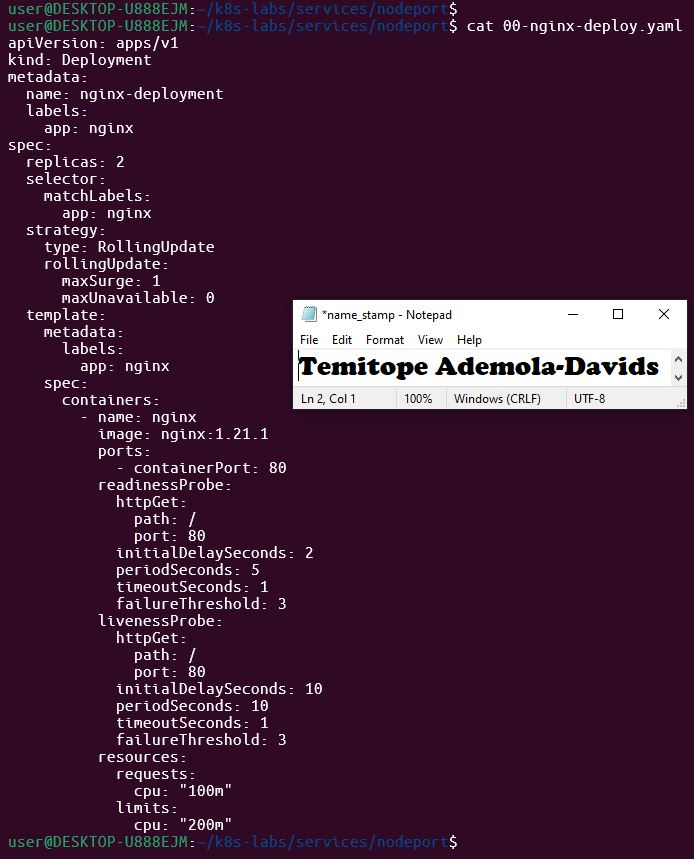

---

#### Screenshot 3 — Output showing successful rollout and two ready NGINX Pods

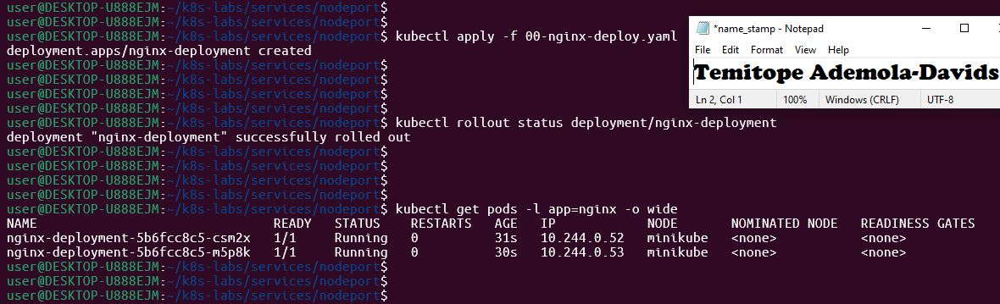

### Notes

**1. Which label will the NodePort Service use to find the NGINX Pods?**

The NodePort Service will use the label selector app: nginx, which matches the labels defined on the Deployment template and pods.

**2. Why must the Pods be ready before they can receive Service traffic?**

Pods must pass their readiness probe to ensure the application inside is fully initialized and capable of serving web requests. If a pod is not ready, Kubernetes excludes its IP address from the Service's endpoint list, preventing clients from hitting broken or starting-up containers.

**3. What port does the NGINX container listen on?**

The NGINX container listens on port 80.

---

# Task 3 — Create the NodePort Service

## Goal

Create a NodePort Service that exposes the NGINX application through a port on every cluster node.

### Evidence

#### Screenshot 4 — Completed `01-nginx-svc-nodeport.yaml` manifest

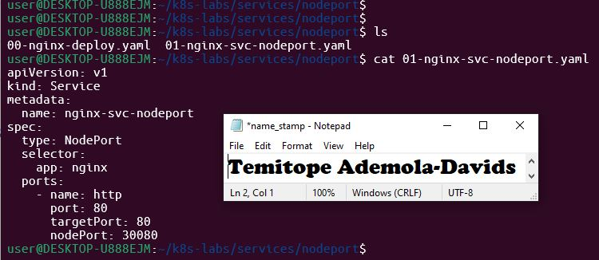

---

#### Screenshot 5 — Output showing the NodePort Service and its endpoints or EndpointSlices

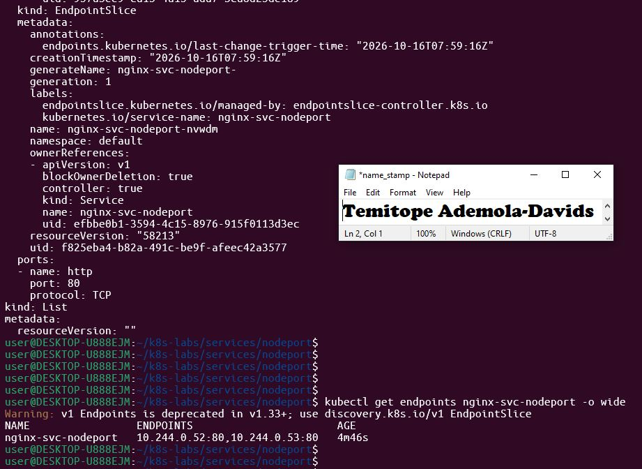

### Notes

**1. What is the purpose of `type: NodePort`?**

type: NodePort instructs Kubernetes to open a specific port across all cluster worker nodes, forwarding incoming traffic on that port directly to the Service.

**2. What is the difference between `port`, `targetPort`, and `nodePort`?**

port: The virtual port exposed internally by the ClusterIP service for other pods within the cluster to use.

targetPort: The port on the backend Pod container where the application (NGINX) is listening.

nodePort: The external port opened on every cluster node IP that external clients connect to.

**3. What NodePort was assigned or selected in your environment?**

 30030 (Your assigned port will vary depending on what Kubernetes auto-assigns in the 30000-32767 range).

**4. Why do Service endpoints need ready Pods?**

Endpoints map traffic to healthy backend instances. If a Pod is not ready, routing traffic to it would result in connection errors, timeouts, or HTTP 5xx errors for users.

---

# Task 4 — Find a Node IP and Test the NodePort

## Goal

Find a reachable node IP and access the NodePort Service.

### Evidence

#### Screenshot 6 — Output of `kubectl get nodes -o wide`

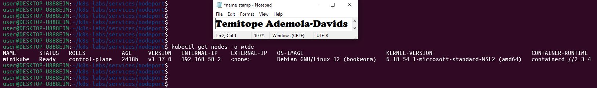

---

#### Screenshot 7 — Output showing the `tester` Pod running

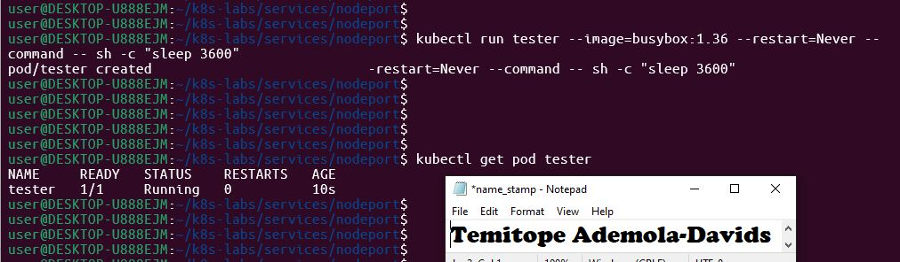

---

#### Screenshot 8 — Successful NodePort response from the laptop or the `tester` Pod

If neither route is supported by your environment, include the failed request output and ready endpoint evidence, and explain the limitation in your Notes.

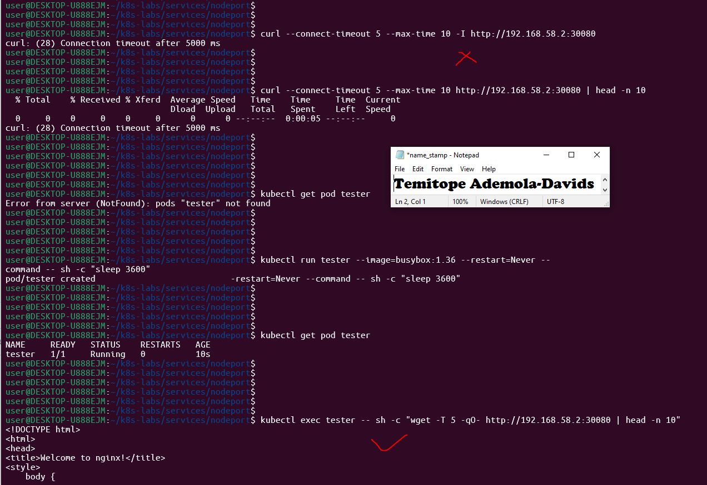

### Notes

**1. Which node IP and NodePort did you test?**

Node Internal IP:192.168.58.2

NodePort: 32614

**2. Was your laptop able to reach the NodePort directly? Explain your result.**

Depending on the environment (like Minikube, kind, or Docker Desktop), direct laptop access might require a specific tunneling command (e.g., minikube service) or port forwarding because the nodes run inside isolated Docker containers or virtual machines. When testing via the in-cluster tester pod using the node internal IP, requests succeed directly because the container shares the internal cluster network path.

**3. Why can external NodePort access behave differently in Minikube, kind, Docker Desktop, and cloud clusters?**

Minikube / kind / Docker Desktop: Nodes run as containerized instances or VMs on a local host, meaning their internal IPs are often not routable directly from your physical laptop unless port forwarding, node port tunnels, or specific Docker network routing bridges are configured.

Cloud Clusters (AWS EKS, Azure AKS, GCP GKE): Nodes are provisioned with routable cloud VPC IPs or virtual network interfaces where security groups, firewalls, and cloud load balancers govern external accessibility.

---

# Task 5 — Optional: Test the Label-Selector Contract

## Goal

Break the Service selector, observe that usable endpoints disappear, and restore the correct selector.

Complete the Evidence and Notes below only if you attempted this optional task.

### Evidence

#### Screenshot 9 — `02-nginx-svc-selector-broken.yaml` showing the incorrect selector

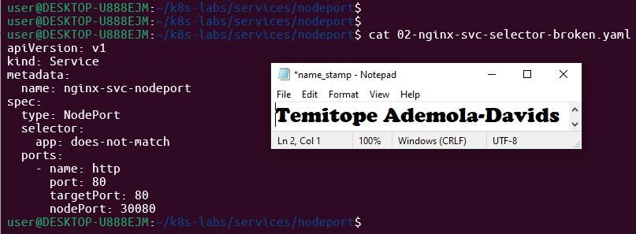

---

#### Screenshot 10 — Empty endpoints or EndpointSlice output after applying the broken selector

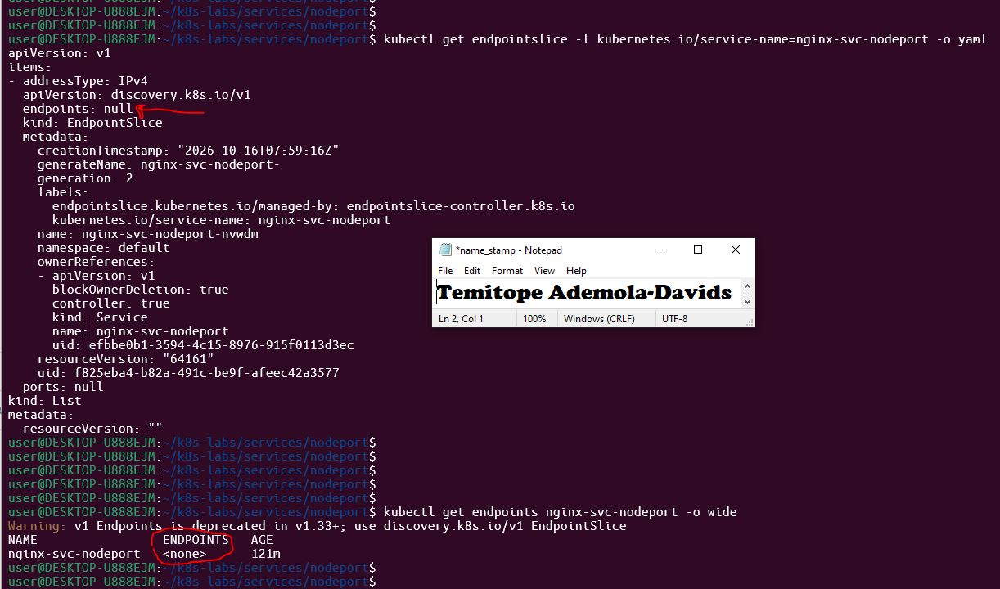

---

#### Screenshot 11 — Restored endpoints or EndpointSlices after applying the original Service manifest

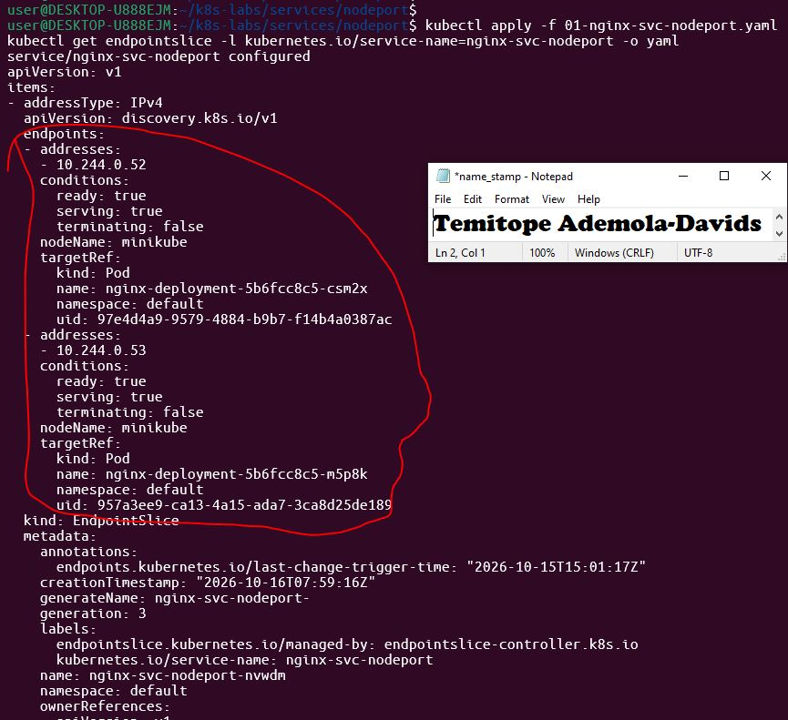

### Notes

**1. Why did the Service endpoints become empty?**

The Service uses its label selector (app: does-not-match) to dynamically query active Pods. Because no running NGINX pods possessed that specific label, the control plane removed all target IP endpoints from the Service.

**2. Why is NodePort only useful when matching ready Pods exist?**

A NodePort service acts as a routing gateway; without active backend endpoints, incoming packets hitting the node port have nowhere to be forwarded, leading to connection timeouts.

**3. How did you restore the backend connectivity?**

By reapplying the original manifest containing the correct selector (app: nginx), which re-establishes the endpoint mappings to the running NGINX pods.

---

# Task 6 — Observe Resilience During Pod Churn

## Goal

Delete one NGINX Pod and observe its replacement while the Service continues routing traffic to available Pods.

### Evidence

#### Screenshot 12 — Output of the Pod deletion command

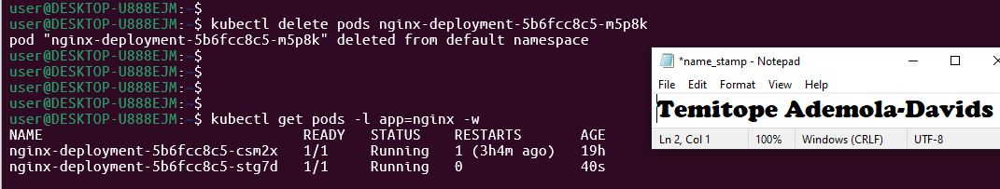

---

#### Screenshot 13 — Output showing the replacement Pod and two running, ready Pods

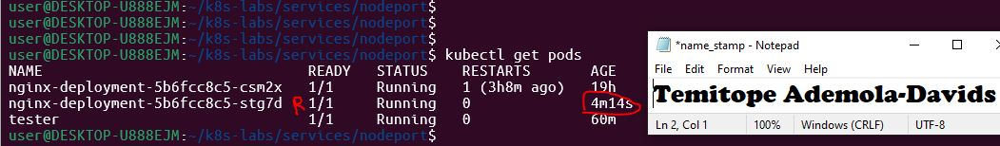

### Notes

**1. What happened after you deleted one Pod?**

The deleted pod terminated immediately, dropping the active replica count to 1. The Kubernetes control plane detected the discrepancy against the desired replica count of 2 and immediately scheduled a brand new replacement Pod.

**2. Which Kubernetes resource created the replacement Pod?**

The Deployment's underlying ReplicaSet managed the lifecycle loop and created the replacement pod

**3. Why can the NodePort Service continue working during Pod churn?**

Because the Deployment maintains multiple replicas (rolling updates with maxUnavailable: 0), at least one healthy NGINX pod remains running and ready to handle incoming requests while the replacement pod initializes. Additionally, EndpointSlices dynamically update to route traffic only to healthy, ready pods.

---

# Task 7 — Share Your NodePort Learning on LinkedIn

## Goal

Share what you learned about NodePort Services, backend Pods, and network access in your Kubernetes environment.

### Evidence

#### Screenshot 14 — Published LinkedIn post about your NodePort Service lab

Add your screenshot here.

#### Linkedin post link

Add your Linkdin post link.

---

# Submission Instructions

- Include the completed YAML manifests created during the lab.
- Add all required screenshots: Screenshots 1–8 and 12–14.
- Include Screenshots 9–11 only if you attempted optional Task 5.
- Complete the Notes for Tasks 1–4 and Task 6.
- Complete Task 5 Notes only if you attempted that task.
- Use clear, readable screenshots showing the relevant commands and outputs.
- Ensure your full name is visible in the required screenshots.
- If NodePort access is restricted by your environment, include the failed request output, ready endpoint evidence, and an explanation.
- Do not expose passwords, access tokens, private keys, kubeconfig contents, or account IDs.

---

# Completion Checklist

- [ ] Created and entered `~/k8s-labs/services/nodeport` (Screenshot 1)
- [ ] Created and applied the NGINX Deployment manifest (Screenshot 2)
- [ ] Confirmed successful rollout and two ready NGINX Pods (Screenshot 3)
- [ ] Created the NodePort Service manifest (Screenshot 4)
- [ ] Verified the Service and its endpoints or EndpointSlices (Screenshot 5)
- [ ] Recorded the assigned or selected NodePort
- [ ] Identified a node IP (Screenshot 6)
- [ ] Confirmed that the `tester` Pod is running (Screenshot 7)
- [ ] Tested NodePort access, or documented the environment limitation with evidence (Screenshot 8)
- [ ] Optional: Tested and restored the Service selector (Screenshots 9–11)
- [ ] Deleted one NGINX Pod (Screenshot 12)
- [ ] Confirmed the replacement Pod and two running, ready Pods (Screenshot 13)
- [ ] Completed all required Notes
- [ ] Published the LinkedIn post (Screenshot 14)
- [ ] No sensitive data exposed

---

## 📌 About DMI & CloudAdvisory

DevOps Micro Internship (DMI) is a project-based DevOps program run by Pravin Mishra (The CloudAdvisory) focused on real-world execution, systems thinking, and career readiness.

It helps learners build strong DevOps foundations with hands-on experience.

---

## 📌 Resources

- 🌐 DMI Official Website: https://dmi.pravinmishra.com?utm_source=github&utm_medium=readme  
- 🎓 University: https://university.pravinmishra.com?utm_source=github&utm_medium=readme  
- 💬 Discord Community: https://discord.pravinmishra.com?utm_source=github&utm_medium=readme  
- 📝 Blog: https://dmi.pravinmishra.com/blog?utm_source=github&utm_medium=readme  
- ▶️ YouTube Playlist: https://www.youtube.com/playlist?list=PLFeSNDtI4Cho  
- 🔗 Pravin Mishra (LinkedIn): https://www.linkedin.com/in/pravin-mishra-aws-trainer/  
- 🏢 CloudAdvisory (LinkedIn): https://www.linkedin.com/company/thecloudadvisory/

---

*This submission is part of DevOps Micro Internship (DMI) — Agentic AI Track.*
