# Assignment 09 — Kubernetes Services: LoadBalancer on AKS

Part of the DevOps Micro Internship (DMI) with Agentic AI

---

## Purpose

Deploy a healthy NGINX application to Azure Kubernetes Service (AKS), expose it publicly using a LoadBalancer Service, observe readiness behavior, and scale the application behind the same public endpoint.

---

# Task 1 — Create or Connect to an AKS Cluster

## Goal

Create a small AKS cluster for this lab, or connect to an existing approved AKS lab cluster.

### Evidence

#### Screenshot 1 — Output of `kubectl get nodes` showing ready AKS node(s)

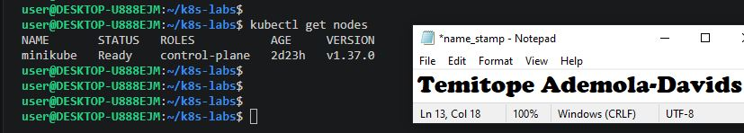

### Notes

**1. Why does this lab use a cloud-capable Kubernetes environment such as AKS for the LoadBalancer Service?**

A standard local Kubernetes cluster (like Minikube or kind) runs inside a local environment and cannot natively provision cloud-provider infrastructure. AKS provides the direct integration with Azure's cloud APIs required to automatically provision external public load balancers and public IP addresses.

**2. What Azure resources can Kubernetes provision when a LoadBalancer Service is created?**

When a LoadBalancer Service is created in AKS, Azure provisions public IP addresses, Azure Load Balancer rules, backend address pools, and frontend configurations to manage incoming internet traffic.

**3. Why is it important to delete unused AKS resources after the lab?**

Cloud infrastructure resources like running AKS nodes, virtual machine disks, and assigned public IP addresses incur continuous financial costs. Cleaning them up avoids unnecessary spending on idle resources.

---

# Task 2 — Set Up Your Lab Directory

## Goal

Create and enter a dedicated directory for the LoadBalancer Service manifests.

### Evidence

#### Screenshot 2 — Terminal showing the output of `pwd` confirming that you are working inside `~/k8s-labs/services/loadbalancer`

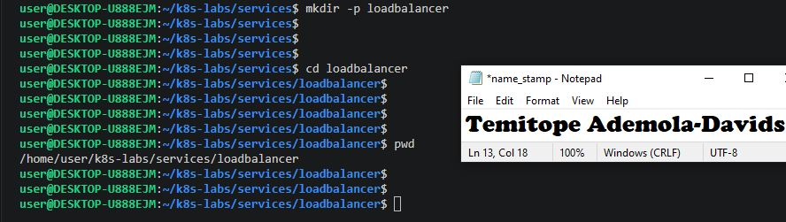

### Notes

**1. Why is it useful to keep Kubernetes manifests organized in dedicated directories?**

Organizing manifests into clean, dedicated paths prevents file clutter, avoids misapplying configurations to the wrong environments, and makes tracking version control or submission evidence much easier.

**2. What are the names of the main Deployment and LoadBalancer Service YAML files you will create in this assignment?**

00-nginx-deploy.yaml for the Deployment and 01-nginx-svc-loadbalancer.yaml for the LoadBalancer Service.

---

# Task 3 — Deploy a Healthy NGINX Application

## Goal

Create a healthy NGINX Deployment with readiness and liveness probes.

### Evidence

#### Screenshot 3 — Completed `00-nginx-deploy.yaml` manifest

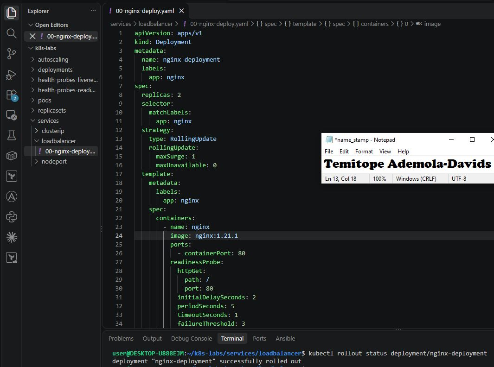

---

#### Screenshot 4 — Output showing successful rollout and two ready NGINX Pods

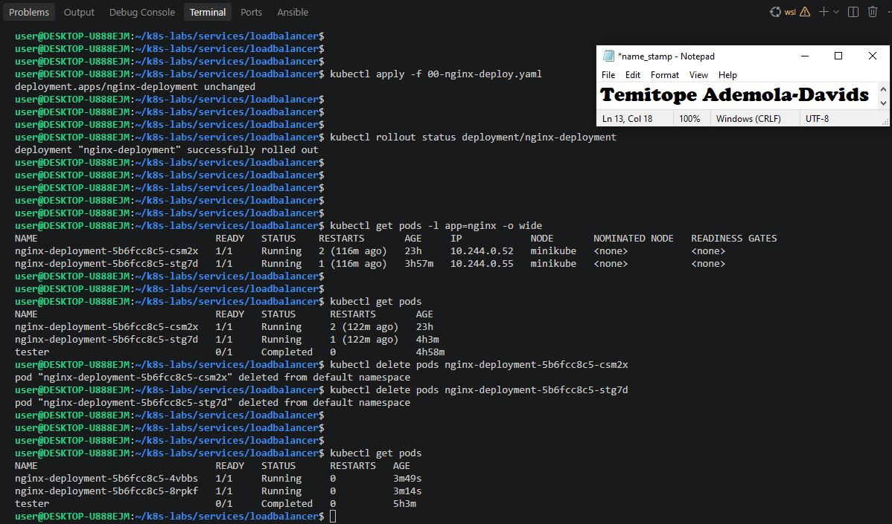

### Notes

**1. Why must Pods be ready before they should receive public traffic?**

Pods must be ready to guarantee that their internal web servers are fully initialized and capable of serving web traffic successfully, preventing users from encountering connection timeouts or errors.

**2. What is the role of the readiness probe in this Deployment?**

The readiness probe checks if the application container is ready to accept incoming traffic; if it fails, Kubernetes automatically stops sending traffic to that specific pod.

**3. What is the role of the liveness probe in this Deployment?**

The liveness probe determines whether the container needs to be restarted. If it fails continuously, Kubernetes kills the unhealthy container and spins up a fresh replacement

---

# Task 4 — Create and Test the LoadBalancer Service

## Goal

Create a public LoadBalancer Service and verify that the NGINX application is reachable from the internet.

### Evidence

#### Screenshot 5 — Completed `01-nginx-svc-loadbalancer.yaml` manifest

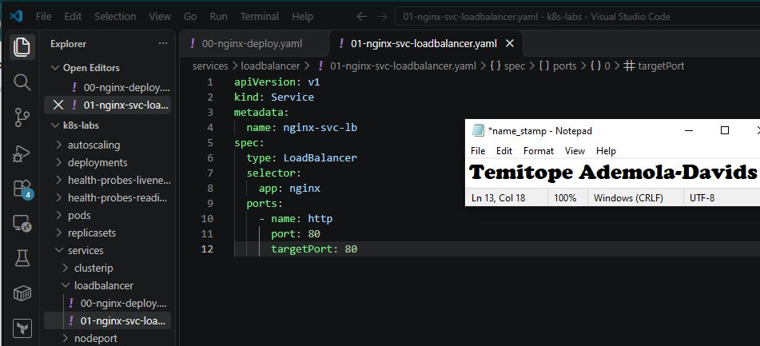

---

#### Screenshot 6 — Output showing the Service with an assigned EXTERNAL-IP

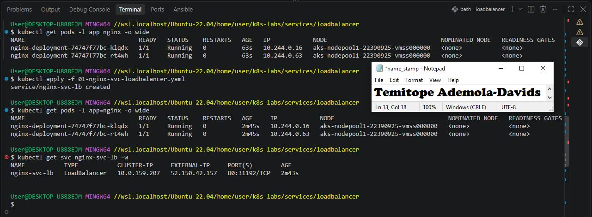

---

#### Screenshot 7 — Successful curl output from the public IP

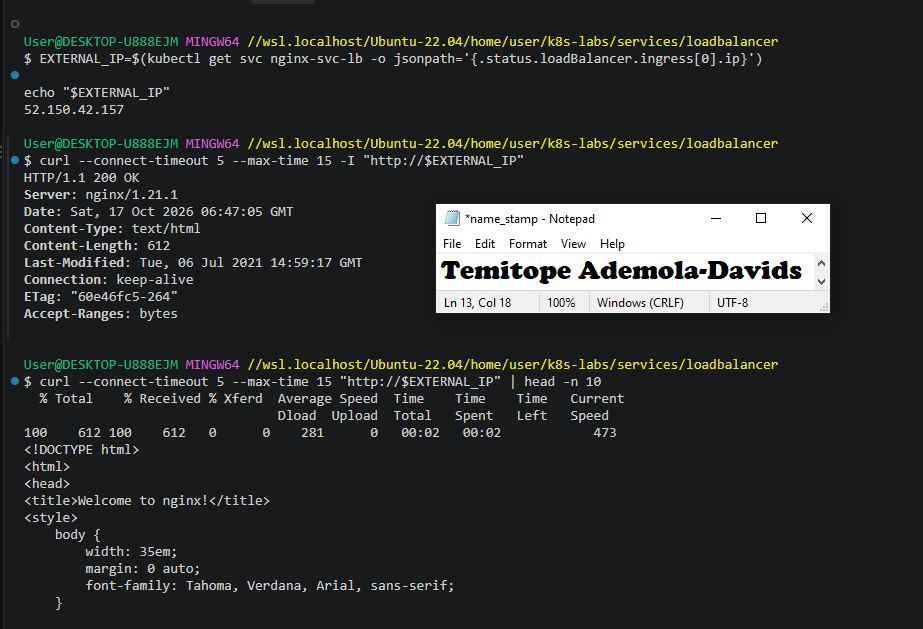

### Notes

**1. What does `type: LoadBalancer` instruct AKS to do?**

It instructs AKS to interact with Azure cloud APIs to automatically provision an external cloud load balancer and associate a public IP address with the cluster service.

**2. What public IP was assigned to your Service?**

http://52.150.42.157

**3. How does the public request eventually reach the NGINX Pods?**

Public requests hit the Azure Load Balancer IP, which routes traffic into cluster nodes via standard node ports, where kube-proxy intercepts it and forwards it to a healthy NGINX pod endpoint.

**4. Why should you wait for EXTERNAL-IP before testing the Service?**

Until Azure finishes provisioning the cloud load balancer and assigns the external IP address, the endpoint does not exist and any requests will fail to connect.

---

# Task 5 — Observe How Readiness Protects Public Traffic

## Goal

Intentionally break readiness and observe how Kubernetes excludes unready Pods from ready Service backends while existing healthy Pods continue serving public traffic.

### Evidence

#### Screenshot 8 — Completed `02-readiness-broken.yaml` patch file

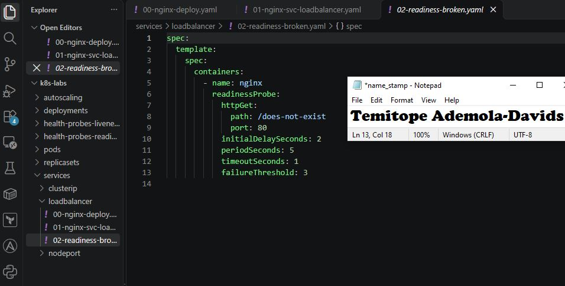

---

#### Screenshot 9 — Output showing the expected incomplete rollout or readiness failure

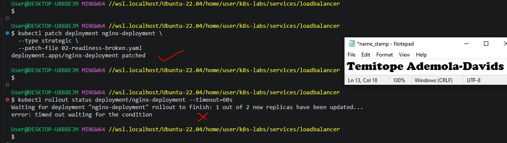

---

#### Screenshot 10 — EndpointSlice output showing ready healthy backends and the effect of the readiness failure

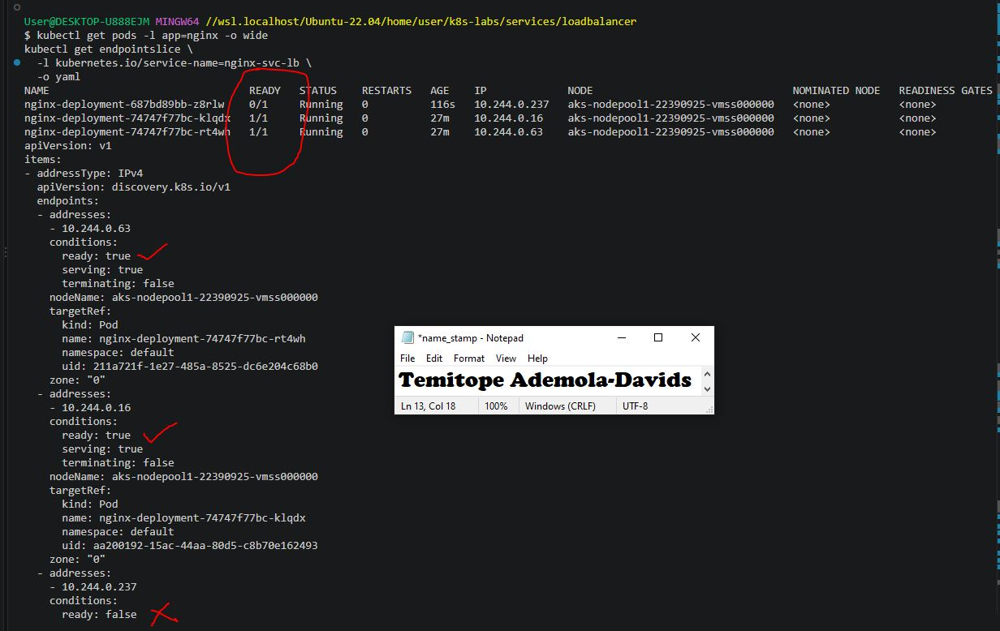

---

#### Screenshot 11 — Successful public curl response after recovery

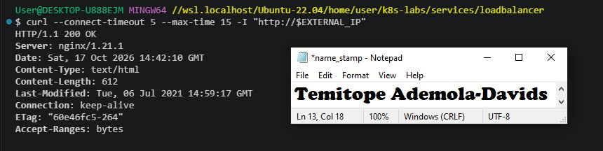

### Notes

**1. Why did the rollout not complete?**

The rollout stalled because the new pod intentionally failed its readiness probe (/does-not-exist), preventing it from transitioning to a ready state.

**2. Why can the public endpoint still work while new Pods fail readiness?**

Because maxUnavailable: 0 ensures existing healthy pods remain running, and Kubernetes automatically excludes unready pods from the service endpoint pool.

**3. What would happen if Kubernetes routed traffic to Pods before they were ready?**

Users would encounter broken connections, connection refused errors, or HTTP 404/500 responses while application containers are still initializing.

**4. How did you restore the Deployment successfully?**

By reapplying the original working Deployment manifest (00-nginx-deploy.yaml), which reinstated the correct readiness probe path (/).

---

# Task 6 — Scale the Deployment Behind the Load Balancer

## Goal

Scale the NGINX Deployment and confirm that more ready Pods become available behind the same public endpoint.

### Evidence

#### Screenshot 12 — Two ready NGINX Pods verified initially; four ready Pods verified after scaling

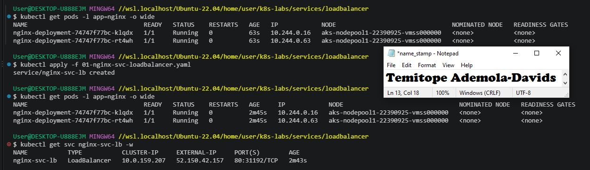
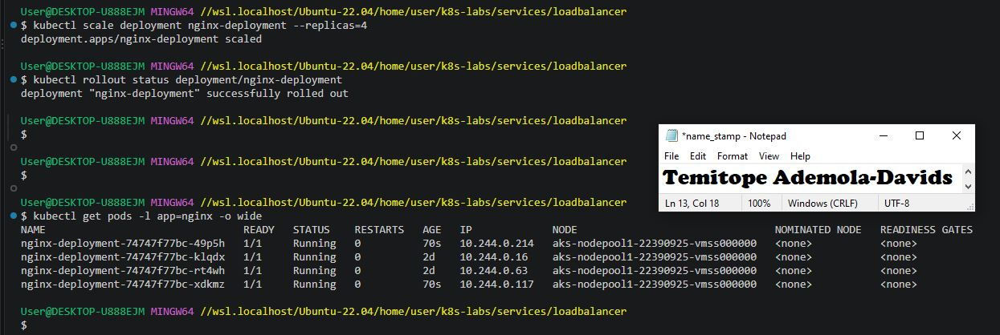

---

#### Screenshot 13 — Successful public curl response after scaling

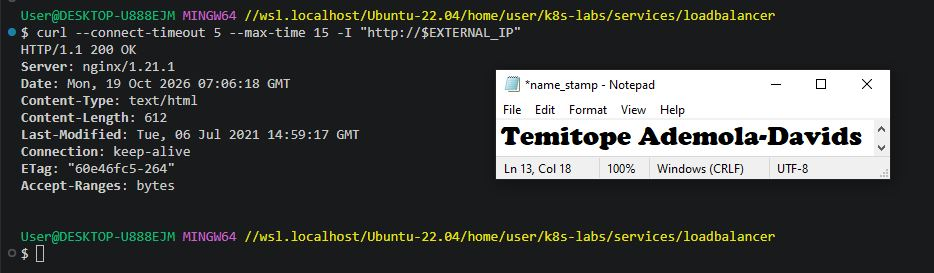

### Notes

**1. What changed after scaling the Deployment from two to four replicas?**

Four running and ready NGINX backend pods became available, and the Service EndpointSlices automatically updated to include all four pod IP addresses.

**2. Did the public IP change after scaling? Explain why or why not.**

No, the public IP remained identical because the Azure Load Balancer and the Kubernetes LoadBalancer Service maintain a stable frontend IP while backend endpoints scale horizontally.

**3. Why does scaling behind a LoadBalancer Service not require users to change the URL or IP they use?**

The LoadBalancer Service acts as a stable abstraction layer, decoupling the external entry point from the internal pool of worker pods.

---

# Task 7 — Share Your LoadBalancer Lab on LinkedIn

## Goal

Share what you learned about exposing an NGINX application publicly through a LoadBalancer Service on AKS.

### Evidence

#### Screenshot 14 — Published LinkedIn post about your LoadBalancer lab on AKS

Add your screenshot here.

#### LinkedIn post link

Add your link here.

---

# Submission Instructions

- Include the completed YAML files:
  - `00-nginx-deploy.yaml`
  - `01-nginx-svc-loadbalancer.yaml`
  - `02-readiness-broken.yaml`
- Add all required screenshots, numbered 1–14, under their corresponding Evidence sections.
- Use clear, readable screenshots showing the relevant commands, configuration, and outputs.
- Ensure your full name is visible in the required screenshots.
- Complete the Notes for Tasks 1–6 in your own words.
- Capture all required evidence before cleaning up Azure resources.
- Plan or complete Azure cleanup according to your lab ownership and reuse arrangements.
- Do not expose passwords, tokens, private keys, cluster credentials, kubeconfig contents, subscription IDs, account IDs, or infrastructure details you are not permitted to share.

---

# Completion Checklist

- [ ] Created or connected to an approved AKS lab cluster
- [ ] Confirmed ready AKS node(s) (Screenshot 1)
- [ ] Created and entered the LoadBalancer lab directory (Screenshot 2)
- [ ] Created the NGINX Deployment manifest (Screenshot 3)
- [ ] Verified successful rollout and two ready NGINX Pods initially (Screenshot 4)
- [ ] Created the LoadBalancer Service manifest (Screenshot 5)
- [ ] Verified the assigned external IP (Screenshot 6)
- [ ] Verified successful public access using curl (Screenshot 7)
- [ ] Created the broken readiness patch (Screenshot 8)
- [ ] Observed the expected incomplete rollout or readiness failure (Screenshot 9)
- [ ] Inspected EndpointSlices during the readiness failure (Screenshot 10)
- [ ] Restored the healthy Deployment and verified public access (Screenshot 11)
- [ ] Scaled the Deployment to four ready Pods and verified updated Service backends (Screenshot 12)
- [ ] Verified public access after scaling (Screenshot 13)
- [ ] Completed the Notes for Tasks 1–6
- [ ] Published the LinkedIn post (Screenshot 14)
- [ ] Included all required YAML files and screenshots
- [ ] Planned or completed Azure cleanup
- [ ] No sensitive data exposed

---

## 📌 About DMI & CloudAdvisory

DevOps Micro Internship (DMI) is a project-based DevOps program run by Pravin Mishra (The CloudAdvisory) focused on real-world execution, systems thinking, and career readiness.

It helps learners build strong DevOps foundations with hands-on experience.

---

## 📌 Resources

- 🌐 DMI Official Website: https://dmi.pravinmishra.com?utm_source=github&utm_medium=readme  
- 🎓 University: https://university.pravinmishra.com?utm_source=github&utm_medium=readme  
- 💬 Discord Community: https://discord.pravinmishra.com?utm_source=github&utm_medium=readme  
- 📝 Blog: https://dmi.pravinmishra.com/blog?utm_source=github&utm_medium=readme  
- ▶️ YouTube Playlist: https://www.youtube.com/playlist?list=PLFeSNDtI4Cho  
- 🔗 Pravin Mishra (LinkedIn): https://www.linkedin.com/in/pravin-mishra-aws-trainer/  
- 🏢 CloudAdvisory (LinkedIn): https://www.linkedin.com/company/thecloudadvisory/

---

*This submission is part of DevOps Micro Internship (DMI) — Agentic AI Track.*
