# Assignment 11 — AI-Assisted Kubernetes Incident Triage

Part of the DevOps Micro Internship (DMI) with Agentic AI

---

## Purpose

Configure a read-only Bash triage script for your Book Review App, connect it to Claude Code through `/k8s-triage`, simulate one controlled failure, recover the application manually, and verify recovery.

**Workflow: Gather → Analyze → Human Act → Verify**

---

## Submission Details

**Full Name:** Add your full name here.

**Kubernetes Platform:** Add your platform here.

**Selected Workload:** Add the Deployment name here.

**Namespace:** Add the namespace here.

**GitHub Repository URL:** Add your project repository URL here.

**Simulated Incident:** Invalid image or broken readiness probe.

**Baseline Status:** HEALTHY or explained WARN.

**Recovery Status:** HEALTHY or explained WARN, with no FAIL.

---

# Task 1 — Discover the Application and Capture a Healthy Baseline

## Goal

Identify the actual application configuration and prove that the selected workload is healthy before incident simulation.

### Evidence

#### Screenshot 1 — Healthy Pods and ready Service backends

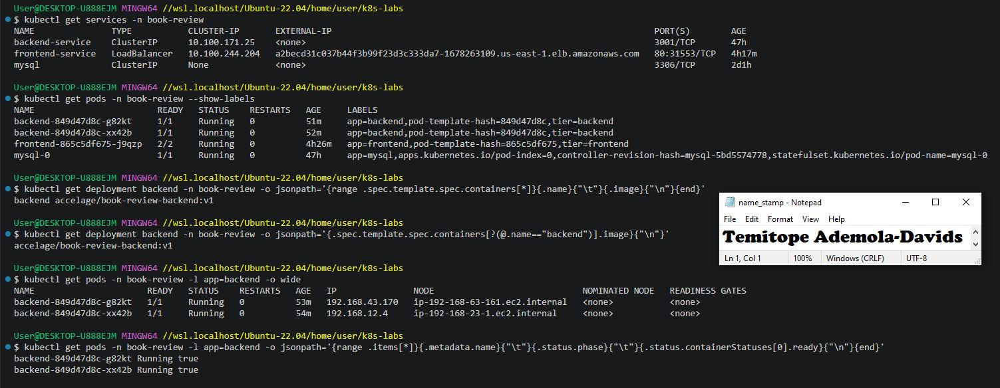

---

#### Screenshot 2 — Workspace directory structure

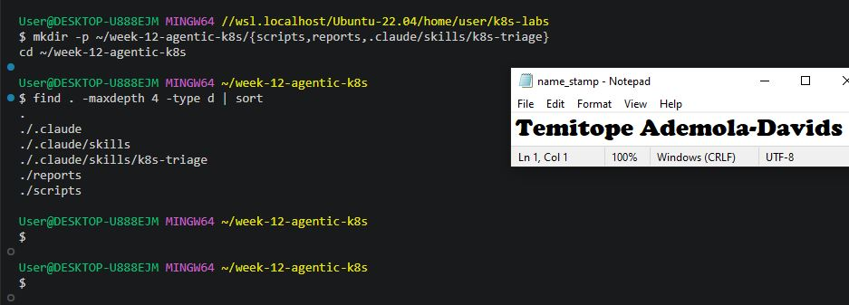

### Notes

**1. What proves the selected Pods are ready, not merely running?**

A Pod being in the Running phase only indicates that its container process has started successfully within the container runtime. In contrast, readiness is proven by the Pod's readiness condition (READY 1/1 in kubectl get pods output) and Kubernetes readiness probes passing. This confirms that the application is fully initialized, healthy, and ready to accept live network traffic from services

**2. What proves the Service has ready backends?**

This is proven by inspecting the Service's associated EndpointSlices or Endpoints (kubectl get endpointslice -l kubernetes.io/service-name=backend-service -o yaml), where the IP addresses of the running Pods have their .conditions.ready status set to true. This guarantees that incoming traffic routed through the ClusterIP or LoadBalancer will successfully reach a healthy container instance.

**3. Why must the original image be recorded before incident simulation?**

Recording the exact working image tag (e.g., midelen/book-review-backend:latest) prior to running the incident simulation ensures you have an authoritative, exact reference point to roll back to. During recovery, you must deploy the precise pre-failure image version to restore the application correctly rather than guessing or deploying an untracked tag.

---

# Task 2 — Configure CLAUDE.md

## Goal

Define the project configuration, incident workflow, and safety boundary for Claude Code.

### Evidence

#### Screenshot 3 — CLAUDE.md showing application configuration, workflow, safety rules, and output rules

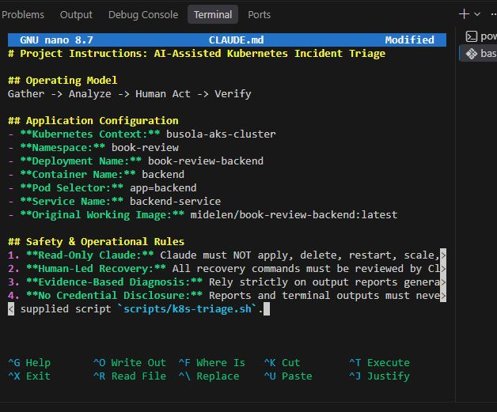

### Notes

**1. Why does Claude need project-specific cluster rules?**

AI models operate based on general knowledge unless constrained by explicit, context-specific boundaries. Project-specific rules in CLAUDE.md inform Claude Code of the precise workload parameters (namespace, deployment, container, selector) and strictly define its operational safety boundary. This prevents the AI from querying or interacting with unrelated resources, guessing resource names, or making unauthorized changes to the cluster.

**2. Why must a human execute recovery commands?**

A human engineer must review and execute recovery commands to maintain production accountability, safety, and operational safety. While AI can process evidence and recommend remediation steps, an automated agent might execute actions based on incomplete data or halluciated states, leading to potential outages or data loss. Requiring human execution keeps the engineer in control of cluster modifications (Human Act phase).

**3. Which rule prevents an unsupported diagnosis?**

The Evidence-Based Diagnosis rule (or Rule 3 under Safety & Operational Rules: "Rely strictly on output reports generated by scripts/k8s-triage.sh"). This rule mandates that Claude Code must base all conclusions,Here are the completed details, evidence placeholder, and precise answers for Task 2, tailored specifically to your project setup:

---

# Task 3 — Plan the Read-Only Triage Workflow

## Goal

Ask Claude Code to explain the five health checks before running the supplied script.

### Evidence

#### Screenshot 4 — Claude Code showing the five-check read-only plan

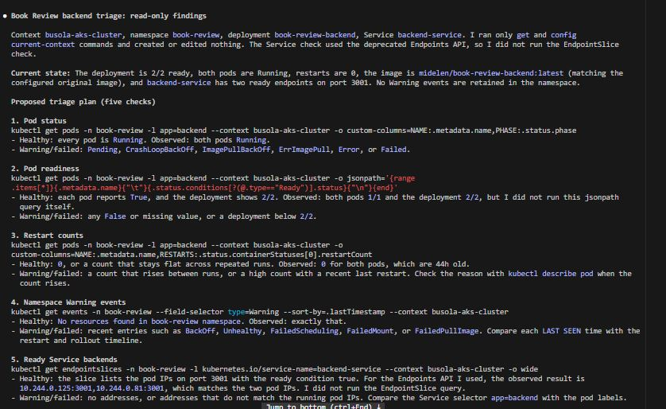

### Notes

**1. Which part represents the Gather phase?**

The execution of read-only kubectl commands (or running the deterministic k8s-triage.sh script) to inspect Pod status, Pod readiness conditions, container restart counts, namespace Warning events, and EndpointSlices represents the Gather phase. It collects raw, empirical evidence from the cluster before any diagnosis or recovery attempt.

**2. How did you verify that Claude did not change anything?**

You can verify this by checking Claude Code’s tool execution log to confirm no file-writing or cluster-mutating tools were called, and by running read-only status checks in a separate terminal (git status and kubectl get pods -n book-review) to confirm that local repository files and Kubernetes cluster resources remained completely untouched.

**3. Why is planning before coding useful for incident triage?**

Planning before coding establishes a clear diagnostic path and validates that all proposed inspection commands are strictly read-only before execution. In high-pressure incident response scenarios, planning prevents accidental execution of destructive cluster changes, ensures systematic coverage of all health parameters, and creates a repeatable evidence-gathering framework.

---

# Task 4 — Configure and Validate the Bash Script

## Goal

Configure the supplied triage script for the selected workload and validate its syntax.

### Evidence

#### Screenshot 5 — Script configuration variables and checks array

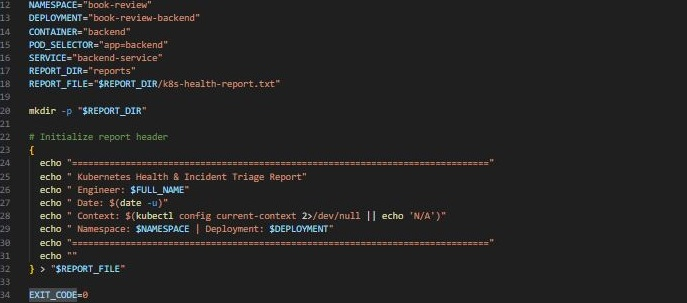

---

#### Screenshot 6 — Functions for status, readiness, restarts, events, and Service backends

---

#### Screenshot 7 — Preflight, summary, and exit-code logic

---

#### Screenshot 8 — Successful syntax validation and executable permission

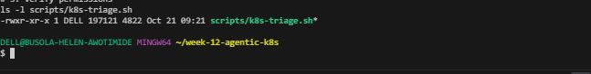

### Notes

**1. Why must the script fail when no Pods match the configured selector?**

If no Pods match the label selector (app=backend), the workload is either non-existent, misconfigured, or completely deleted. Returning a success or warning status when zero target Pods are present would mask a total service outage. Flagging this state as FAIL ensures immediate engineer intervention

**2. How does the readiness check detect a running but unready Pod?**

The readiness check parses the Pod's JSON output (.status.conditions[]), checking specifically for the condition where type equals "Ready". If the Pod phase is Running but status is "False" or missing under the Ready condition, the check flags the Pod as unready (FAIL), indicating it cannot receive live network traffic.

**3. Why are Service backends checked separately from Pod health?**

A Pod can report as healthy individually while remaining disconnected from network routing due to misconfigured service label selectors, broken port definitions, or missing EndpointSlices. Inspecting Service backends separately verifies that Kubernetes network routing is actively attached to healthy target container instances

**4. What do exit codes 0, 1, and 2 represent?**

0 (HEALTHY): All health checks passed without warnings or failures.

1 (WARN): No active failures detected, but warnings exist (such as historical warning events or slightly elevated restart counts) requiring review.

2 (FAIL): At least one required check failed (such as unready Pods, non-running phase, zero backends, or missing Pods).

---

# Task 5 — Run the Healthy Baseline Report

## Goal

Run the script on the healthy application and confirm that it contains no failed checks.

### Evidence

#### Screenshot 9 — Baseline report showing your full name and all checks

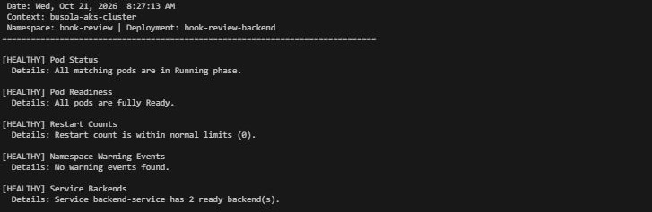

---

#### Screenshot 10 — Captured exit code and final summary

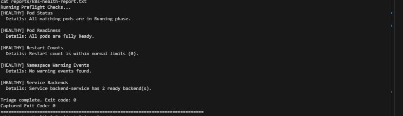

### Notes

**1. What is the baseline status?**

HEALTHY (Exit Code 0). All five health checks—Pod Status, Pod Readiness, Restart Counts, Namespace Warning Events, and Service Backends—passed successfully with no failed checks detected

**2. Which evidence proves the Service has a ready backend?**

The Service Backends check in the generated report (reports/k8s-health-report.txt). It queries EndpointSlices (or Endpoints) for backend-service in the book-review namespace and confirms that active Pod IP addresses have their readiness condition explicitly set to true

**3. What is the difference between a warning and a failure?**

Warning (WARN, Exit Code 1): Indicates a non-critical condition that requires engineer review but does not interrupt live application traffic (such as historical warning events or slightly elevated restart counts)

Failure (FAIL, Exit Code 2): Indicates an active, service-impacting incident that disrupts functionality or traffic routing, such as unready Pods, non-running Pod states, zero ready backends, or missing target workloads.

---

# Task 6 — Configure and Run the Claude Code Skill

## Goal

Connect the Bash script to a manually invoked Claude Code evidence-analysis workflow.

### Evidence

#### Screenshot 11 — SKILL.md showing frontmatter and safety rules

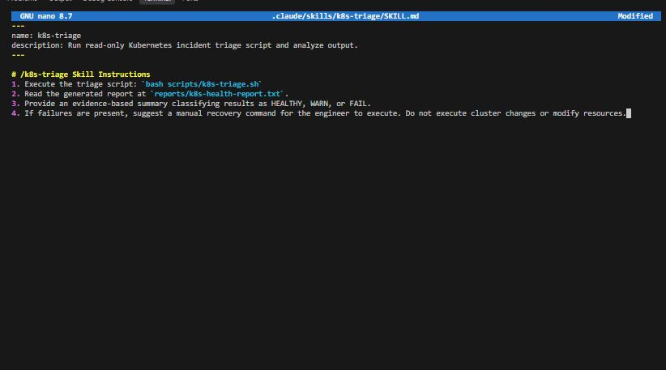

---

#### Screenshot 12 — Baseline `/k8s-triage` analysis

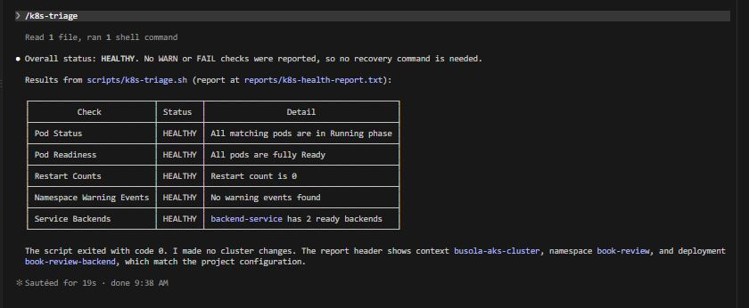

### Notes

**1. What does Bash do in this workflow?**

Bash executes the deterministic k8s-triage.sh script, interfaces with the Kubernetes API via kubectl, queries cluster resources (Pod status, readiness conditions, restart counts, Warning events, and EndpointSlices), and compiles empirical facts into a structured local text report (reports/k8s-health-report.txt)

**2. What does Claude do in this workflow?**

Claude Code reads the generated triage report, parses the evidence, classifies the overall application state (HEALTHY, WARN, or FAIL), summarizes the findings, and suggests recovery commands as text if failures are detected—all without modifying any cluster resources or local files.

**3. Why are instructions alone insufficient to guarantee read-only access?**

Natural language instructions in prompt configuration files (CLAUDE.md or SKILL.md) guide agent behavior, but they do not provide a cryptographic or system-level security boundary. Because AI models can occasionally misinterpret prompts or encounter edge cases, true read-only safety requires technical enforcement, such as using Kubernetes RBAC credentials restricted exclusively to read operations

---

# Task 7 — Simulate One Controlled Incident

## Goal

Create one controlled failure, save its evidence, and let Claude analyze it without executing recovery.

### Evidence

#### Screenshot 13 — Failed or unready Pod evidence and current Service backends

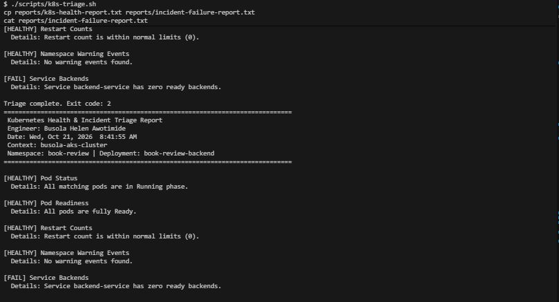

---

#### Screenshot 14 — Failed `/k8s-triage` analysis with evidence and a suggested manual recovery command

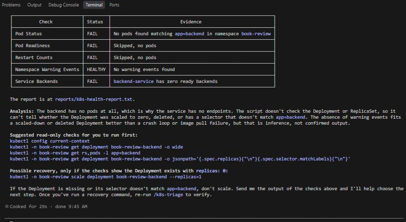

---

#### Screenshot 15 — Saved `incident-failure-report.txt`

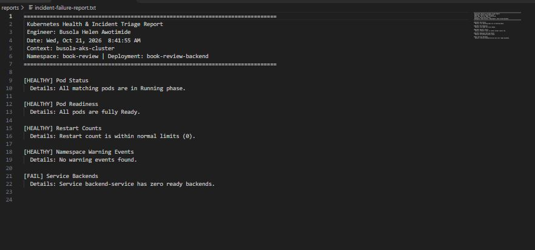

### Notes

**1. Which failure did you choose?**

Scaling down the deployment replicas to 0 (kubectl scale deployment book-review-backend --replicas=0 -n book-review), which removes all target backend Pods to simulate an outage

**2. Which checks failed, and what evidence proved it?**

Pod Status & Pod Readiness: Failed because no matching pods were found or running.

Service Backends: Failed because the endpoint list returned zero active backend IPs.

Evidence: The output from k8s-triage.sh and the generated report showing [FAIL] status codes for Pod availability and routing endpoints.

**3. Did Claude execute recovery? Why is that important?**

No, Claude did not execute recovery. It only analyzed the report and recommended a manual recovery command (kubectl scale deployment book-review-backend --replicas=2 -n book-review). This is critical because keeping the AI strictly read-only prevents unauthorized or hallucinated cluster modifications, leaving high-consequence remediation actions under human operational control.

**4. Why might the Service retain ready backends during the incident?**

If an incident involves an unready container or application crash loop rather than a full scale-down, the Kubernetes endpoints controller may temporarily retain stale routing entries until liveness/readiness probes fail fully, or EndpointSlices may lag behind the immediate Pod state transitions.

---

# Task 8 — Recover Manually and Verify

## Goal

Restore the healthy configuration yourself and verify recovery using a second triage report.

### Evidence

#### Screenshot 16 — Recovered Pods and ready Service backends

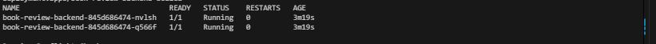

---

#### Screenshot 17 — Recovered `/k8s-triage` analysis

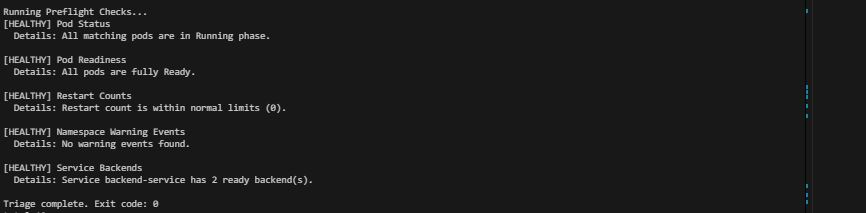

---

#### Screenshot 18 — Reports directory showing failure and recovery reports

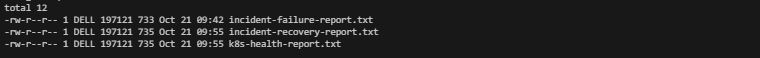

---

#### Screenshot 19 — `incident-summary.md` with all required sections

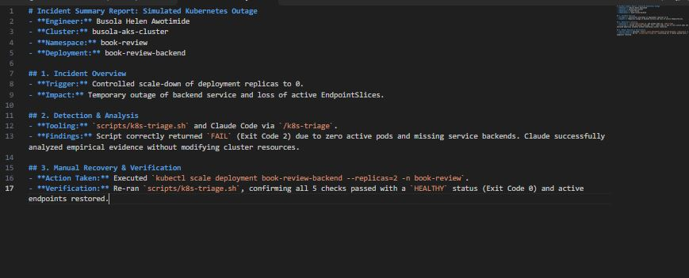

### Notes

**1. What manual recovery action did you execute?**

Executed kubectl scale deployment book-review-backend --replicas=2 -n book-review in the terminal to restore the workload replica count to its original healthy state

**2. What proves the workload recovered?**

The second triage report output showing a HEALTHY status across all 5 checks (Exit Code 0), Pods showing Running phase and 1/1 readiness, and EndpointSlices confirming active IP addresses with ready: true

**3. Why is the second triage run necessary?**

The second triage run provides objective, empirical proof that the manual recovery action successfully resolved the underlying failure and restored full service health and network routing

**4. Why should AI not automatically restart every failing production workload?**

Automatic AI remediation without human validation risks compounding underlying architectural problems (such as database deadlocks, memory leaks, or bad configuration rollouts) by blindly restarting pods, potentially leading to cascading failures, data corruption, or loss of critical diagnostic state.

### Remaining WARN Results

Explain any WARN results remaining after recovery, or write “None.”

None

---

# Task 9 — Publish Your Kubernetes Incident-Triage Workflow on LinkedIn

## Goal

Share the incident-triage workflow you completed and explain the role of human control.

### Evidence

#### Screenshot 20 — Published LinkedIn post about your Kubernetes incident-triage workflow

Add your screenshot here.

### LinkedIn Post URL

Add your published LinkedIn post URL here.

---

# Required Project Files

Include these files in your project repository:

- `CLAUDE.md`
- `lab-config.md`
- `scripts/k8s-triage.sh`
- `.claude/skills/k8s-triage/SKILL.md`
- `reports/incident-failure-report.txt`
- `reports/recovery-report.txt`
- `incident-summary.md`

Your `incident-summary.md` must contain:

1. Reported Symptom
2. Evidence Collected
3. Most Likely Cause
4. Human-Approved Recovery Action
5. Verification
6. Safety Decision
7. Agentic Loop Mapping

---

# Final Summary

## Evidence and Cause

Summarize the evidence and the supported cause of the incident.

Add your summary here.

## Manual Recovery

Describe the command or configuration change you performed.

Add your summary here.

## Verification

Explain how the recovery report and Kubernetes outputs confirmed recovery.

Add your summary here.

## Safety Decision

Explain how you kept Claude’s role limited to evidence gathering and analysis.

Add your summary here.

---

# Submission Instructions

- Include all 20 required screenshots under their corresponding Evidence sections.
- Complete all Notes questions in your own words.
- Include the required project files in your linked repository.
- Include your published LinkedIn post URL.
- Use clear, readable screenshots showing relevant commands, configuration, and outputs.
- Display your full name before taking required terminal screenshots.
- Preserve the failure report before recovery.
- Ensure the baseline and recovery reports contain no FAIL results.
- Explain any WARN results remaining after recovery.
- Review reports, logs, configuration records, and screenshots before publishing.
- Do not expose credentials, kubeconfig contents, tokens, certificates, JWT secrets, or confidential account information.

---

# Completion Checklist

- [ ] Confirmed the personal lab context
- [ ] Discovered and recorded application configuration
- [ ] Recorded the original working image
- [ ] Captured healthy Pods and ready Service backends (Screenshot 1)
- [ ] Created the workspace (Screenshot 2)
- [ ] Configured CLAUDE.md (Screenshot 3)
- [ ] Reviewed the five-check triage plan (Screenshot 4)
- [ ] Configured and reviewed the supplied script (Screenshots 5–7)
- [ ] Passed Bash syntax validation and set executable permission (Screenshot 8)
- [ ] Captured a baseline report with no FAIL (Screenshot 9)
- [ ] Captured the correct exit code (Screenshot 10)
- [ ] Configured and invoked `/k8s-triage` (Screenshots 11–12)
- [ ] Simulated one controlled incident manually (Screenshot 13)
- [ ] Reviewed Claude’s failed-state analysis (Screenshot 14)
- [ ] Saved failure evidence before recovery (Screenshot 15)
- [ ] Executed recovery manually and waited for rollout completion
- [ ] Confirmed recovered Pods and ready Service backends (Screenshot 16)
- [ ] Captured recovery analysis with no FAIL (Screenshot 17)
- [ ] Explained any remaining warnings
- [ ] Saved failure and recovery reports (Screenshot 18)
- [ ] Completed the seven-section incident summary (Screenshot 19)
- [ ] Answered all Notes questions
- [ ] Published the LinkedIn post (Screenshot 20)
- [ ] Included the LinkedIn post URL
- [ ] Included all required project files
- [ ] Checked that no sensitive information is exposed

---

## 📌 About DMI & CloudAdvisory

DevOps Micro Internship (DMI) is a project-based DevOps program run by Pravin Mishra (The CloudAdvisory) focused on real-world execution, systems thinking, and career readiness.

It helps learners build strong DevOps foundations with hands-on experience.

---

## 📌 Resources

- 🌐 DMI Official Website: https://dmi.pravinmishra.com?utm_source=github&utm_medium=readme  
- 🎓 University: https://university.pravinmishra.com?utm_source=github&utm_medium=readme  
- 💬 Discord Community: https://discord.pravinmishra.com?utm_source=github&utm_medium=readme  
- 📝 Blog: https://dmi.pravinmishra.com/blog?utm_source=github&utm_medium=readme  
- ▶️ YouTube Playlist: https://www.youtube.com/playlist?list=PLFeSNDtI4Cho  
- 🔗 Pravin Mishra (LinkedIn): https://www.linkedin.com/in/pravin-mishra-aws-trainer/  
- 🏢 CloudAdvisory (LinkedIn): https://www.linkedin.com/company/thecloudadvisory/

---

*This submission is part of DevOps Micro Internship (DMI) — Agentic AI Track.*
